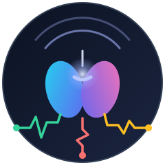

# thalamus

The realtime perception layer over the systems an organization runs. Thalamus reads numbers from
the instruments those systems already expose (metrics, logs, databases, orchestrators, version
control, test runs), records each reading as a typed **sample**, grades it into a **verdict**
against a baseline, and answers: *what is out of bounds right now, compared with what is normal for
it?*

It pairs with [cortex](https://github.com/beyond10x/cortex): thalamus perceives, cortex remembers.
Most samples stay in thalamus; verdict transitions and daily rollups reach cortex as
evidence-backed facts.

| | |
|---|---|
| status | design only, no code yet |
| design | [docs/design/thalamus.md](docs/design/thalamus.md) |
| language | Rust: libraries plus a service and a CLI |
| secrets | none; every source is a [Connectors](https://github.com/beyond10x/connectors) connection |

Agents start at [AGENTS.md](AGENTS.md).
