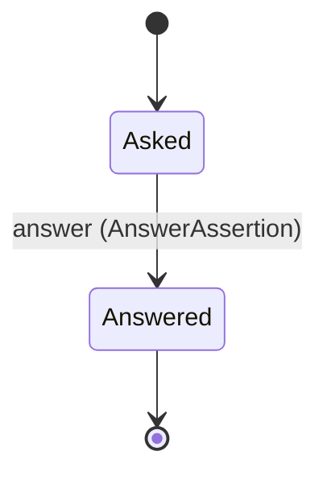
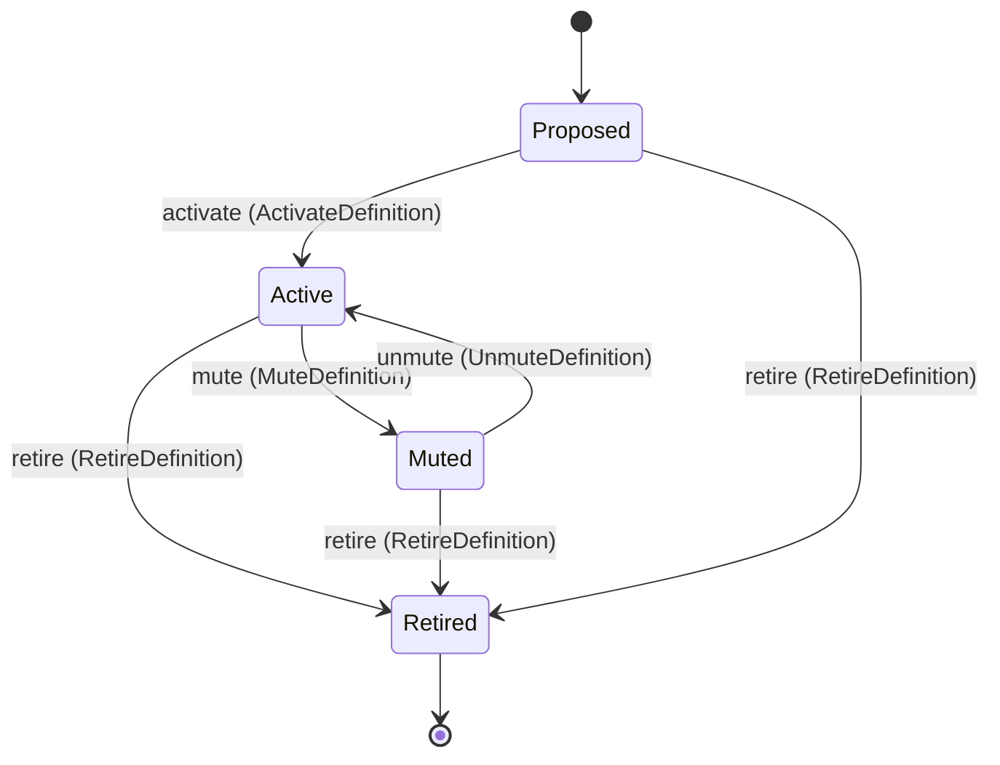
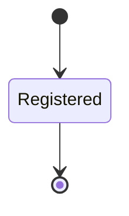
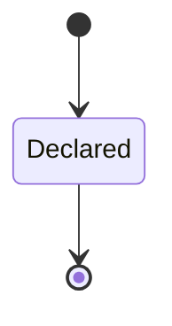
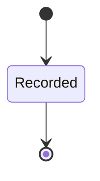

<!--
generated from thalamus v1
model digest 827e774bfdab74d78674ef1f90b801f077677fc03bc8c865ffa778e5b79217a0
contract digest slice-sha256/2:20dc5e2c939861ed74d9e6e990993b3de24a986b5b01c3a740f048885522cb7b
do not edit: regenerate with `ess generate`
-->

# Assertions

A caller (a release, a merge request, a test run, a controller) asks whether named signals stayed within baseline over a window, and thalamus answers with a result, not a guess. Unknown is not a pass.

`thalamus.assertion` is one of thalamus's bounded contexts. [Back to the index](../index.md).

## Types

### `Asker`

`thalamus.assertion.Asker` is a record of two fields:

- `kind` — `thalamus.assertion.AskerKind`
- `ref` — `String`

### `AskerKind`

`thalamus.assertion.AskerKind` is one of `release`, `merge_request`, `test_run` and `controller`.

### `AssertionId`

`thalamus.assertion.AssertionId` wraps `String` and is not interchangeable with one: the whole value of naming it separately is the crossings the model then refuses. Every value starts with `asr_`.

### `AssertionResult`

`thalamus.assertion.AssertionResult` is one of `within`, `breach` and `unknown`.

| variant | `passes` |
|---|---|
| `within` | `true` |
| `breach` | `false` |
| `unknown` | `false` |

### `Within`

`thalamus.assertion.Within` is one of `baseline`.

## Entities

An entity is what this context is about: something with an identity that outlives any one request, a shape, and a lifecycle. The lifecycle is exhaustive — a move that is not drawn below is a move this specification does not permit, and that is the only way it says so. Every move is labelled with the command that takes it, because a move nothing can trigger is refused rather than drawn.

### `Assertion`

`thalamus.assertion.Assertion`.

An instance is identified by `assertion_id`, a `thalamus.assertion.AssertionId`. The name is part of the model and not a convention: a view projects the identity under that name, so a projection inventing its own would disagree with the view.

It holds:

- `signals` — `List<thalamus.definition.SignalId>`
- `dims` — `Map<String, thalamus.dimension.DimensionValue>`
- `after` — `Timestamp`
- `horizon` — `Duration`
- `within` — `thalamus.assertion.Within`
- `asker` — `thalamus.assertion.Asker`
- `result` — `Optional<thalamus.assertion.AssertionResult>`, which may be absent
- `worst` — `Optional<thalamus.evaluation.Verdict>`, which may be absent
- `reason` — `Optional<String>`, which may be absent

It references any number of [`thalamus.definition.SignalDefinition`](thalamus-definition.md#signaldefinition), as `signals`, carried by `Assertion.signals`.

Every instance satisfies `((state == Asked and not (defined(result)) and not (defined(worst)) and not (defined(reason))) or (state == Answered and defined(result) and defined(worst)))` — a predicate over this entity's own fields, checked against them rather than stored as a sentence, so an invariant reading something the entity does not have is refused instead of documented.

Its state is a `thalamus.assertion.Assertion.State`, one of `Answered` and `Asked`. That enum is synthesised from the lifecycle rather than declared beside it, so the states a view's filter compares and the states drawn below cannot disagree.

An instance is created in `Asked`. `Answered` is terminal, so an instance may rest there forever. That is declared rather than inferred from having no way out: an entity that cannot leave a state is either finished or stuck, and only its author knows which.

Each move is taken by a declared command outcome, and a move nothing takes is refused as `missing_causation` rather than left as a state change nobody can trigger:

- `answer` — taken by `thalamus.assertion.AnswerAssertion` on its `answered` outcome

An instance is brought into existence by `thalamus.assertion.AskAssertion` on its `asked` outcome.

Illegal transitions are illegal by absence: no rule forbids them, there is simply no arrow, because a rule would be a second place for the same truth to live. A diagram cannot show an absence, so the pairs it does not connect are listed here, derived from the same transitions — anything named below is a move this specification does not permit.

- `Answered` may not become `Asked`

Two views project it: [`Assertions`](#assertions) and [`OpenAssertions`](#openassertions).

## Views

A view is what the outside world is promised it can observe. Each one says which instances it contains and how soon it reflects a command that has already returned, because "you can read this" without "how soon" is the promise every flaky suite is built on.

### `Assertions`

`thalamus.assertion.Assertions`, shown to a person as "Assertions" and called `assertions` on the wire.

It reads [`Assertion`](#assertion).

It contains every instance of that entity: no filter narrows it, which is a decision somebody made and not a line somebody omitted.

It exposes:

- `assertion_id` — `thalamus.assertion.AssertionId`
- `signals` — `List<thalamus.definition.SignalId>`
- `dims` — `Map<String, thalamus.dimension.DimensionValue>`
- `after` — `Timestamp`
- `horizon` — `Duration`
- `within` — `thalamus.assertion.Within`
- `asker` — `thalamus.assertion.Asker`
- `result` — `Optional<thalamus.assertion.AssertionResult>`, which may be absent
- `worst` — `Optional<thalamus.evaluation.Verdict>`, which may be absent
- `reason` — `Optional<String>`, which may be absent
- `state` — `thalamus.assertion.Assertion.State`

It declares no order, so the rows come back in whatever order the implementation has, and two reads may disagree.

**Read-your-writes**: it is current the moment the command that changed it returns. A caller that has just created an invoice and cannot see it in here has been told a lie about what it did.

A generated scenario asserts it once, immediately after the command: a view promising this and not keeping the promise has to fail the suite rather than be retried until it passes.

### `OpenAssertions`

`thalamus.assertion.OpenAssertions`, shown to a person as "Open assertions" and called `open` on the wire.

It reads [`Assertion`](#assertion).

It contains the instances where `state == Asked` holds, and only those — so an instance a caller cannot find in here has been filtered out rather than lost.

It exposes:

- `assertion_id` — `thalamus.assertion.AssertionId`
- `signals` — `List<thalamus.definition.SignalId>`
- `after` — `Timestamp`
- `horizon` — `Duration`
- `asker` — `thalamus.assertion.Asker`

It declares no order, so the rows come back in whatever order the implementation has, and two reads may disagree.

**Read-your-writes**: it is current the moment the command that changed it returns. A caller that has just created an invoice and cannot see it in here has been told a lie about what it did.

A generated scenario asserts it once, immediately after the command: a view promising this and not keeping the promise has to fail the suite rather than be retried until it passes.

## Commands

### `AnswerAssertion`

`thalamus.assertion.AnswerAssertion`, shown to a person as "Answer an assertion" and called `answer` on the wire.

It takes:

- `assertion_id` — `thalamus.assertion.AssertionId`
- `result` — `thalamus.assertion.AssertionResult`
- `worst` — `thalamus.evaluation.Verdict`
- `reason` — `Optional<String>`, which may be absent

It has five outcomes.

**`reason-missing`** — breach or unknown came without a reason; nothing was answered. Taken when `(result != within and not (defined(reason)))` holds of the input. No entity in this specification changes. It reports `thalamus.assertion.ReasonRequired`, carrying `result`. It emits nothing. A test reaches it by constructing an input that satisfies that condition.

**`contradicts-verdict`** — The result and the worst verdict disagree; nothing was answered. Taken when `((result == breach and worst in [OK, N_A, UNKNOWN]) or (result != breach and worst in [WARN, CRIT]) or (result == within and worst == UNKNOWN))` holds of the input. No entity in this specification changes. It reports `thalamus.assertion.ResultContradictsVerdict`, carrying `result` and `worst`. It emits nothing. A test reaches it by constructing an input that satisfies that condition.

**`answered`** — The assertion is answered; the asker reads the result, and only within passes. The default branch, taken when no other outcome's condition matched. It moves a `thalamus.assertion.Assertion` from `Asked` to `Answered`, along the declared move `answer`. The instance is the one named by the input field `assertion_id`. It emits `thalamus.assertion.AssertionAnswered`. It sets `result` from `input.result`, `worst` from `input.worst` and `reason` from `input.reason`. A test reaches it by constructing an input that satisfies no other outcome's condition.

**`wrong-state`** — The assertion is already answered; nothing changed. Taken when the subject is resting in a state none of this command's moves start from — a `thalamus.assertion.Assertion` in `Answered`, which is what is left of the lifecycle once this command's own moves are taken away. The document lists none of it. No entity in this specification changes. It reports `thalamus.assertion.AssertionStateConflict`, carrying `current`. It emits nothing. A test reaches it by driving an instance into one of those states and then issuing the command, because no input selects this branch.

**`no-such-assertion`** — No assertion has this id; nothing changed. Taken when the identity the command names is one no record carries, before any other answer for it. No entity in this specification changes. It reports `thalamus.assertion.UnknownAssertion`, carrying `assertion_id`. It emits nothing. A test reaches it by sending an identity no record carries, arranging nothing.

### `AskAssertion`

`thalamus.assertion.AskAssertion`, shown to a person as "Ask an assertion" and called `ask` on the wire.

It takes:

- `signals` — `List<thalamus.definition.SignalId>`
- `dims` — `Map<String, thalamus.dimension.DimensionValue>`
- `after` — `Timestamp`
- `horizon` — `Duration`
- `within` — `thalamus.assertion.Within`
- `asker` — `thalamus.assertion.Asker`

It has two outcomes.

**`no-signals`** — No signal was named; nothing was asked. Taken when `signals.count == 0` holds of the input. No entity in this specification changes. It reports `thalamus.assertion.NoSignals`. It emits nothing. A test reaches it by constructing an input that satisfies that condition.

**`asked`** — The assertion is open and its id returned; it is answered once its horizon has passed. The default branch, taken when no other outcome's condition matched. It creates a `thalamus.assertion.Assertion`, which starts in `Asked`. The new instance's identity is published as `assertion_id` on `thalamus.assertion.AssertionAsked`. It emits `thalamus.assertion.AssertionAsked`. It sets `signals` from `input.signals`, `dims` from `input.dims`, `after` from `input.after`, `horizon` from `input.horizon`, `within` from `input.within` and `asker` from `input.asker`. A test reaches it by constructing an input that satisfies no other outcome's condition.

## Events

### `AssertionAnswered`

`thalamus.assertion.AssertionAnswered`.

It carries:

- `assertion_id` — `thalamus.assertion.AssertionId`
- `asker` — `thalamus.assertion.Asker`
- `result` — `thalamus.assertion.AssertionResult`
- `worst` — `thalamus.evaluation.Verdict`

Emitted by `thalamus.assertion.AnswerAssertion` on its `answered` outcome.

Nothing in this system reacts to it.

### `AssertionAsked`

`thalamus.assertion.AssertionAsked`.

It carries:

- `assertion_id` — `thalamus.assertion.AssertionId`
- `asker` — `thalamus.assertion.Asker`

Emitted by `thalamus.assertion.AskAssertion` on its `asked` outcome.

Nothing in this system reacts to it.

## Errors

### `AssertionStateConflict`

The assertion is already answered; nothing changed.

It carries:

- `current` — `thalamus.assertion.Assertion.State`

Reported by `thalamus.assertion.AnswerAssertion` on its `wrong-state` outcome.

### `NoSignals`

An assertion names at least one signal; none was named, so nothing was asked.

It carries nothing beyond its name, so a caller can tell what went wrong and not which value caused it.

Reported by `thalamus.assertion.AskAssertion` on its `no-signals` outcome.

### `ReasonRequired`

A breach or unknown result carries a reason; none was given, so nothing was answered.

It carries:

- `result` — `thalamus.assertion.AssertionResult`

Reported by `thalamus.assertion.AnswerAssertion` on its `reason-missing` outcome.

### `ResultContradictsVerdict`

breach goes with a worst verdict of WARN or CRIT and only then, and within never goes with UNKNOWN; the answer broke that, so nothing was answered.

It carries:

- `result` — `thalamus.assertion.AssertionResult`
- `worst` — `thalamus.evaluation.Verdict`

Reported by `thalamus.assertion.AnswerAssertion` on its `contradicts-verdict` outcome.

### `UnknownAssertion`

No assertion has this id; nothing changed.

It carries:

- `assertion_id` — `thalamus.assertion.AssertionId`

Reported by `thalamus.assertion.AnswerAssertion` on its `no-such-assertion` outcome.

## Actors

An actor is who may ask this context for something. Every grant below points at a command this specification declares — a grant is a resolved reference, so "may invoke" something nobody wrote is not a permission this model can express, and an authorisation that authorises nothing cannot ship quietly.

### `Answerer`

`thalamus.assertion.Answerer`.

It may invoke [`AnswerAssertion`](#answerassertion).

### `Caller`

`thalamus.assertion.Caller`.

It may invoke [`AskAssertion`](#askassertion).

---

Generated from thalamus v1 · model digest `827e774bfdab74d78674ef1f90b801f077677fc03bc8c865ffa778e5b79217a0` · contract digest `slice-sha256/2:20dc5e2c939861ed74d9e6e990993b3de24a986b5b01c3a740f048885522cb7b`. Do not edit this file; change the specification and regenerate it with `ess generate`.

<!--
generated from thalamus v1
model digest 827e774bfdab74d78674ef1f90b801f077677fc03bc8c865ffa778e5b79217a0
contract digest slice-sha256/2:da86c782b76717f788219c1cf2b2cdc7cbde53e3e751494ccccf05c06cf3add2
do not edit: regenerate with `ess generate`
-->

# Signal definitions

What is measured and how. One copy of every threshold lives here and nowhere else.

`thalamus.definition` is one of thalamus's bounded contexts. [Back to the index](../index.md).

## Types

### `AdapterId`

`thalamus.definition.AdapterId` wraps `String` and is not interchangeable with one: the whole value of naming it separately is the crossings the model then refuses. Its characters are drawn from `abcdefghijklmnopqrstuvwxyz0123456789_`.

### `Author`

`thalamus.definition.Author` wraps `String` and is not interchangeable with one: the whole value of naming it separately is the crossings the model then refuses.

### `BaselineKind`

`thalamus.definition.BaselineKind` is one of `offset_1d`, `offset_7d`, `pooled`, `higher_of`, `lower_of`, `same_slot_median_4w`, `rolling_median` and `fixed`.

### `ConnectionId`

`thalamus.definition.ConnectionId` wraps `String` and is not interchangeable with one: the whole value of naming it separately is the crossings the model then refuses. Its characters are drawn from `abcdefghijklmnopqrstuvwxyzABCDEFGHIJKLMNOPQRSTUVWXYZ0123456789_-.:/`.

### `DenominatorSpec`

`thalamus.definition.DenominatorSpec` is a record of three fields:

- `unit` — `thalamus.definition.Unit`
- `min_n` — `Integer`
- `since` — `String`

### `EvaluationSpec`

`thalamus.definition.EvaluationSpec` is a record of five fields:

- `rule` — `thalamus.definition.RuleId`
- `baselines` — `List<thalamus.definition.BaselineKind>`
- `warn` — `Optional<thalamus.definition.Threshold>`, which may be absent
- `crit` — `Optional<thalamus.definition.Threshold>`, which may be absent
- `min_trend_window` — `Optional<Duration>`, which may be absent

### `ExtractorId`

`thalamus.definition.ExtractorId` wraps `String` and is not interchangeable with one: the whole value of naming it separately is the crossings the model then refuses.

### `Family`

`thalamus.definition.Family` wraps `String` and is not interchangeable with one: the whole value of naming it separately is the crossings the model then refuses. Its characters are drawn from `abcdefghijklmnopqrstuvwxyz0123456789_`.

### `History`

`thalamus.definition.History` is one of `source` and `store`.

### `Links`

`thalamus.definition.Links` is a record of two fields:

- `components` — `List<String>`
- `issues` — `List<String>`

### `Owner`

`thalamus.definition.Owner` wraps `String` and is not interchangeable with one: the whole value of naming it separately is the crossings the model then refuses.

### `QueryText`

`thalamus.definition.QueryText` wraps `String` and is not interchangeable with one: the whole value of naming it separately is the crossings the model then refuses.

### `RuleId`

`thalamus.definition.RuleId` wraps `String` and is not interchangeable with one: the whole value of naming it separately is the crossings the model then refuses.

### `SignalId`

`thalamus.definition.SignalId` wraps `String` and is not interchangeable with one: the whole value of naming it separately is the crossings the model then refuses. Its characters are drawn from `abcdefghijklmnopqrstuvwxyz0123456789_.`.

### `SignalKind`

`thalamus.definition.SignalKind` is one of `gauge`, `counter_increase`, `ratio`, `instant` and `count_of_cases`.

### `Source`

`thalamus.definition.Source` is a record of two fields:

- `adapter` — `thalamus.definition.AdapterId`
- `connection` — `thalamus.definition.ConnectionId`

### `Threshold`

`thalamus.definition.Threshold` is a record of three fields:

- `x` — `Optional<Decimal>`, which may be absent
- `abs` — `Optional<Decimal>`, which may be absent
- `min_events` — `Optional<Integer>`, which may be absent

### `Unit`

`thalamus.definition.Unit` wraps `String` and is not interchangeable with one: the whole value of naming it separately is the crossings the model then refuses. Its characters are drawn from `!"#$%&'()*+,-./0123456789:;<=>?@ABCDEFGHIJKLMNOPQRSTUVWXYZ[\]^_`abcdefghijklmnopqrstuvwxyz{|}~`.

## Entities

An entity is what this context is about: something with an identity that outlives any one request, a shape, and a lifecycle. The lifecycle is exhaustive — a move that is not drawn below is a move this specification does not permit, and that is the only way it says so. Every move is labelled with the command that takes it, because a move nothing can trigger is refused rather than drawn.

### `SignalDefinition`

`thalamus.definition.SignalDefinition`.

An instance is identified by `signal_id`, a `thalamus.definition.SignalId`. The name is part of the model and not a convention: a view projects the identity under that name, so a projection inventing its own would disagree with the view.

It holds:

- `title` — `String`
- `family` — `thalamus.definition.Family`
- `kind` — `thalamus.definition.SignalKind`
- `unit` — `Optional<thalamus.definition.Unit>`, which may be absent
- `dimensions` — `Optional<List<thalamus.dimension.DimensionKey>>`, which may be absent
- `source` — `thalamus.definition.Source`
- `extractor` — `thalamus.definition.ExtractorId`
- `query` — `Map<String, thalamus.definition.QueryText>`
- `window` — `Duration`
- `cadence` — `Duration`
- `history` — `thalamus.definition.History`
- `denominator` — `Optional<thalamus.definition.DenominatorSpec>`, which may be absent
- `evaluation` — `thalamus.definition.EvaluationSpec`
- `objective` — `Optional<Json>`, which may be absent
- `owner` — `Optional<thalamus.definition.Owner>`, which may be absent
- `links` — `thalamus.definition.Links`
- `rev` — `Integer`
- `revised_at` — `Timestamp`
- `revised_by` — `thalamus.definition.Author`
- `mute_reason` — `Optional<String>`, which may be absent
- `mute_until` — `Optional<Timestamp>`, which may be absent

It declares no relation to another entity, and no other entity names it.

Every instance satisfies `rev >= 1`, `(state == Proposed or state == Retired or (defined(unit) and defined(dimensions) and defined(denominator) and defined(owner)))` and `((state == Muted and defined(mute_reason) and defined(mute_until)) or (state != Muted and not (defined(mute_reason)) and not (defined(mute_until))))` — a predicate over this entity's own fields, checked against them rather than stored as a sentence, so an invariant reading something the entity does not have is refused instead of documented.

Its state is a `thalamus.definition.SignalDefinition.State`, one of `Active`, `Muted`, `Proposed` and `Retired`. That enum is synthesised from the lifecycle rather than declared beside it, so the states a view's filter compares and the states drawn below cannot disagree.

An instance is created in `Proposed`. `Retired` is terminal, so an instance may rest there forever. That is declared rather than inferred from having no way out: an entity that cannot leave a state is either finished or stuck, and only its author knows which.

Each move is taken by a declared command outcome, and a move nothing takes is refused as `missing_causation` rather than left as a state change nobody can trigger:

- `activate` — taken by `thalamus.definition.ActivateDefinition` on its `activated` outcome
- `mute` — taken by `thalamus.definition.MuteDefinition` on its `muted` outcome
- `unmute` — taken by `thalamus.definition.UnmuteDefinition` on its `unmuted` outcome
- `retire` — taken by `thalamus.definition.RetireDefinition` on its `retired` outcome

An instance is brought into existence by `thalamus.definition.ProposeDefinition` on its `proposed` outcome.

Illegal transitions are illegal by absence: no rule forbids them, there is simply no arrow, because a rule would be a second place for the same truth to live. A diagram cannot show an absence, so the pairs it does not connect are listed here, derived from the same transitions — anything named below is a move this specification does not permit.

- `Active` may not become `Proposed`
- `Muted` may not become `Proposed`
- `Proposed` may not become `Muted`
- `Retired` may not become `Active`
- `Retired` may not become `Muted`
- `Retired` may not become `Proposed`

Two views project it: [`ActiveDefinitions`](#activedefinitions) and [`Definitions`](#definitions).

## Views

A view is what the outside world is promised it can observe. Each one says which instances it contains and how soon it reflects a command that has already returned, because "you can read this" without "how soon" is the promise every flaky suite is built on.

### `ActiveDefinitions`

`thalamus.definition.ActiveDefinitions`, shown to a person as "Active definitions" and called `active` on the wire.

It reads [`SignalDefinition`](#signaldefinition).

It contains the instances where `state == Active` holds, and only those — so an instance a caller cannot find in here has been filtered out rather than lost.

It exposes:

- `signal_id` — `thalamus.definition.SignalId`
- `title` — `String`
- `family` — `thalamus.definition.Family`
- `kind` — `thalamus.definition.SignalKind`
- `unit` — `Optional<thalamus.definition.Unit>`, which may be absent
- `dimensions` — `Optional<List<thalamus.dimension.DimensionKey>>`, which may be absent
- `source` — `thalamus.definition.Source`
- `cadence` — `Duration`
- `owner` — `Optional<thalamus.definition.Owner>`, which may be absent
- `rev` — `Integer`

It declares no order, so the rows come back in whatever order the implementation has, and two reads may disagree.

**Read-your-writes**: it is current the moment the command that changed it returns. A caller that has just created an invoice and cannot see it in here has been told a lie about what it did.

A generated scenario asserts it once, immediately after the command: a view promising this and not keeping the promise has to fail the suite rather than be retried until it passes.

### `Definitions`

`thalamus.definition.Definitions`, shown to a person as "Definitions" and called `definitions` on the wire.

It reads [`SignalDefinition`](#signaldefinition).

It contains every instance of that entity: no filter narrows it, which is a decision somebody made and not a line somebody omitted.

It exposes:

- `signal_id` — `thalamus.definition.SignalId`
- `title` — `String`
- `family` — `thalamus.definition.Family`
- `kind` — `thalamus.definition.SignalKind`
- `unit` — `Optional<thalamus.definition.Unit>`, which may be absent
- `dimensions` — `Optional<List<thalamus.dimension.DimensionKey>>`, which may be absent
- `source` — `thalamus.definition.Source`
- `extractor` — `thalamus.definition.ExtractorId`
- `query` — `Map<String, thalamus.definition.QueryText>`
- `window` — `Duration`
- `cadence` — `Duration`
- `history` — `thalamus.definition.History`
- `denominator` — `Optional<thalamus.definition.DenominatorSpec>`, which may be absent
- `objective` — `Optional<Json>`, which may be absent
- `owner` — `Optional<thalamus.definition.Owner>`, which may be absent
- `links` — `thalamus.definition.Links`
- `rev` — `Integer`
- `revised_at` — `Timestamp`
- `revised_by` — `thalamus.definition.Author`
- `mute_reason` — `Optional<String>`, which may be absent
- `mute_until` — `Optional<Timestamp>`, which may be absent
- `state` — `thalamus.definition.SignalDefinition.State`

It declares no order, so the rows come back in whatever order the implementation has, and two reads may disagree.

**Read-your-writes**: it is current the moment the command that changed it returns. A caller that has just created an invoice and cannot see it in here has been told a lie about what it did.

A generated scenario asserts it once, immediately after the command: a view promising this and not keeping the promise has to fail the suite rather than be retried until it passes.

## Commands

### `ActivateDefinition`

`thalamus.definition.ActivateDefinition`, shown to a person as "Activate a definition" and called `activate` on the wire.

It takes:

- `signal_id` — `thalamus.definition.SignalId`

It has four outcomes.

**`incomplete`** — Unit, dimensions, denominator or owner is missing; the definition stays Proposed. Taken when the existing subject's stored fields satisfy `(not (defined(unit)) or not (defined(dimensions)) or not (defined(denominator)) or not (defined(owner)))`. No entity in this specification changes. It reports `thalamus.definition.IncompleteDefinition`, carrying `signal_id`. It emits nothing. A test establishes and independently observes the subject enum fact before selecting this branch.

**`activated`** — The definition is Active; the scheduler samples it on its cadence. The default branch, taken when no other outcome's condition matched. It moves a `thalamus.definition.SignalDefinition` from `Proposed` to `Active`, along the declared move `activate`. The instance is the one named by the input field `signal_id`. It emits `thalamus.definition.DefinitionActivated`. A test reaches it by constructing an input that satisfies no other outcome's condition.

**`wrong-state`** — The definition is not Proposed; nothing changed. Taken when the subject is resting in a state none of this command's moves start from — a `thalamus.definition.SignalDefinition` in `Active`, `Muted` and `Retired`, which is what is left of the lifecycle once this command's own moves are taken away. The document lists none of it. No entity in this specification changes. It reports `thalamus.definition.DefinitionStateConflict`, carrying `current`. It emits nothing. A test reaches it by driving an instance into one of those states and then issuing the command, because no input selects this branch.

**`no-such-definition`** — No definition has this id; nothing changed. Taken when the identity the command names is one no record carries, before any other answer for it. No entity in this specification changes. It reports `thalamus.definition.UnknownDefinition`, carrying `signal_id`. It emits nothing. A test reaches it by sending an identity no record carries, arranging nothing.

### `MuteDefinition`

`thalamus.definition.MuteDefinition`, shown to a person as "Mute a definition" and called `mute` on the wire.

It takes:

- `signal_id` — `thalamus.definition.SignalId`
- `reason` — `String`
- `until` — `Timestamp`

It has four outcomes.

**`expiry-passed`** — The expiry is not in the future; nothing was muted. Taken when `until <= now` holds of the input. No entity in this specification changes. It reports `thalamus.definition.MuteExpiryPassed`, carrying `until`. It emits nothing. A test reaches it by constructing an input that satisfies that condition.

**`muted`** — The definition is Muted and carries its reason and expiry. The default branch, taken when no other outcome's condition matched. It moves a `thalamus.definition.SignalDefinition` from `Active` to `Muted`, along the declared move `mute`. The instance is the one named by the input field `signal_id`. It emits `thalamus.definition.DefinitionMuted`. It sets `mute_reason` from `input.reason` and `mute_until` from `input.until`. A test reaches it by constructing an input that satisfies no other outcome's condition.

**`wrong-state`** — The definition is not Active; nothing changed. Taken when the subject is resting in a state none of this command's moves start from — a `thalamus.definition.SignalDefinition` in `Muted`, `Proposed` and `Retired`, which is what is left of the lifecycle once this command's own moves are taken away. The document lists none of it. No entity in this specification changes. It reports `thalamus.definition.DefinitionStateConflict`, carrying `current`. It emits nothing. A test reaches it by driving an instance into one of those states and then issuing the command, because no input selects this branch.

**`no-such-definition`** — No definition has this id; nothing changed. Taken when the identity the command names is one no record carries, before any other answer for it. No entity in this specification changes. It reports `thalamus.definition.UnknownDefinition`, carrying `signal_id`. It emits nothing. A test reaches it by sending an identity no record carries, arranging nothing.

### `ProposeDefinition`

`thalamus.definition.ProposeDefinition`, shown to a person as "Propose a definition" and called `propose` on the wire.

It takes:

- `signal_id` — `thalamus.definition.SignalId`
- `title` — `String`
- `family` — `thalamus.definition.Family`
- `kind` — `thalamus.definition.SignalKind`
- `unit` — `Optional<thalamus.definition.Unit>`, which may be absent
- `dimensions` — `Optional<List<thalamus.dimension.DimensionKey>>`, which may be absent
- `source` — `thalamus.definition.Source`
- `extractor` — `thalamus.definition.ExtractorId`
- `query` — `Map<String, thalamus.definition.QueryText>`
- `window` — `Duration`
- `cadence` — `Duration`
- `history` — `thalamus.definition.History`
- `denominator` — `Optional<thalamus.definition.DenominatorSpec>`, which may be absent
- `evaluation` — `thalamus.definition.EvaluationSpec`
- `objective` — `Optional<Json>`, which may be absent
- `owner` — `Optional<thalamus.definition.Owner>`, which may be absent
- `links` — `thalamus.definition.Links`
- `author` — `thalamus.definition.Author`

It has three outcomes.

**`instant-not-fixed`** — An instant signal declared a baseline other than fixed; nothing was proposed. Taken when `(kind == instant and exists b in evaluation.baselines: (b != fixed))` holds of the input. No entity in this specification changes. It reports `thalamus.definition.InstantNeedsFixedBaseline`, carrying `signal_id`. It emits nothing. A test reaches it by constructing an input that satisfies that condition.

**`proposed`** — The definition exists at revision 1 and is Proposed. The default branch, taken when no other outcome's condition matched. It creates a `thalamus.definition.SignalDefinition`, which starts in `Proposed`. The new instance's identity is published as `signal_id` on `thalamus.definition.DefinitionProposed`. It emits `thalamus.definition.DefinitionProposed`. It sets `title` from `input.title`, `family` from `input.family`, `kind` from `input.kind`, `unit` from `input.unit`, `dimensions` from `input.dimensions`, `source` from `input.source`, `extractor` from `input.extractor`, `query` from `input.query`, `window` from `input.window`, `cadence` from `input.cadence`, `history` from `input.history`, `denominator` from `input.denominator`, `evaluation` from `input.evaluation`, `objective` from `input.objective`, `owner` from `input.owner`, `links` from `input.links`, `rev` from `"1"`, `revised_at` from `implementation-generated` and `revised_by` from `input.author`. A test reaches it by constructing an input that satisfies no other outcome's condition.

**`already-defined`** — The id is taken; nothing changed. Taken when a record already carries the identity the command's creating branch would create, and no input-guarded refusal applies. No entity in this specification changes. It reports `thalamus.definition.DefinitionExists`, carrying `signal_id`. It emits nothing. A test reaches it by sending the command twice with one identity: the first call creates the record, the second is answered by this branch.

### `RetireDefinition`

`thalamus.definition.RetireDefinition`, shown to a person as "Retire a definition" and called `retire` on the wire.

It takes:

- `signal_id` — `thalamus.definition.SignalId`

It has three outcomes.

**`retired`** — The definition is Retired; it is never sampled again. The default branch, taken when no other outcome's condition matched. It moves a `thalamus.definition.SignalDefinition` from `Active`, `Muted` and `Proposed` to `Retired`, along the declared move `retire`. The instance is the one named by the input field `signal_id`. It emits `thalamus.definition.DefinitionRetired`. It sets `mute_reason` cleared and `mute_until` cleared. A test reaches it by constructing an input that satisfies no other outcome's condition.

**`wrong-state`** — The definition is already Retired; nothing changed. Taken when the subject is resting in a state none of this command's moves start from — a `thalamus.definition.SignalDefinition` in `Retired`, which is what is left of the lifecycle once this command's own moves are taken away. The document lists none of it. No entity in this specification changes. It reports `thalamus.definition.DefinitionStateConflict`, carrying `current`. It emits nothing. A test reaches it by driving an instance into one of those states and then issuing the command, because no input selects this branch.

**`no-such-definition`** — No definition has this id; nothing changed. Taken when the identity the command names is one no record carries, before any other answer for it. No entity in this specification changes. It reports `thalamus.definition.UnknownDefinition`, carrying `signal_id`. It emits nothing. A test reaches it by sending an identity no record carries, arranging nothing.

### `ReviseDefinition`

`thalamus.definition.ReviseDefinition`, shown to a person as "Revise a definition" and called `revise` on the wire.

It takes:

- `signal_id` — `thalamus.definition.SignalId`
- `title` — `String`
- `family` — `thalamus.definition.Family`
- `kind` — `thalamus.definition.SignalKind`
- `unit` — `thalamus.definition.Unit`
- `dimensions` — `List<thalamus.dimension.DimensionKey>`
- `source` — `thalamus.definition.Source`
- `extractor` — `thalamus.definition.ExtractorId`
- `query` — `Map<String, thalamus.definition.QueryText>`
- `window` — `Duration`
- `cadence` — `Duration`
- `history` — `thalamus.definition.History`
- `denominator` — `thalamus.definition.DenominatorSpec`
- `evaluation` — `thalamus.definition.EvaluationSpec`
- `objective` — `Optional<Json>`, which may be absent
- `owner` — `thalamus.definition.Owner`
- `links` — `thalamus.definition.Links`
- `author` — `thalamus.definition.Author`

It has four outcomes.

**`retired`** — The definition is retired; nothing changed. Taken when the existing subject's stored fields satisfy `state == Retired`. No entity in this specification changes. It reports `thalamus.definition.RetiredDefinition`, carrying `signal_id`. It emits nothing. A test establishes and independently observes the subject enum fact before selecting this branch.

**`instant-not-fixed`** — An instant signal declared a baseline other than fixed; nothing changed. Taken when `(kind == instant and exists b in evaluation.baselines: (b != fixed))` holds of the input. No entity in this specification changes. It reports `thalamus.definition.InstantNeedsFixedBaseline`, carrying `signal_id`. It emits nothing. A test reaches it by constructing an input that satisfies that condition.

**`revised`** — The body is replaced and rev is one higher; evaluations already recorded keep the rev they name. The default branch, taken when no other outcome's condition matched. It changes a `thalamus.definition.SignalDefinition` without moving it along its lifecycle. The instance is the one named by the input field `signal_id`. It emits `thalamus.definition.DefinitionRevised`. It sets `title` from `input.title`, `family` from `input.family`, `kind` from `input.kind`, `unit` from `input.unit`, `dimensions` from `input.dimensions`, `source` from `input.source`, `extractor` from `input.extractor`, `query` from `input.query`, `window` from `input.window`, `cadence` from `input.cadence`, `history` from `input.history`, `denominator` from `input.denominator`, `evaluation` from `input.evaluation`, `objective` from `input.objective`, `owner` from `input.owner`, `links` from `input.links`, `rev` from `its previous value plus 1`, `revised_at` from `implementation-generated` and `revised_by` from `input.author`. A test reaches it by constructing an input that satisfies no other outcome's condition.

**`no-such-definition`** — No definition has this id; nothing changed. Taken when the identity the command names is one no record carries, before any other answer for it. No entity in this specification changes. It reports `thalamus.definition.UnknownDefinition`, carrying `signal_id`. It emits nothing. A test reaches it by sending an identity no record carries, arranging nothing.

### `UnmuteDefinition`

`thalamus.definition.UnmuteDefinition`, shown to a person as "Unmute a definition" and called `unmute` on the wire.

It takes:

- `signal_id` — `thalamus.definition.SignalId`

It has three outcomes.

**`unmuted`** — The definition is Active again and carries no mute. The default branch, taken when no other outcome's condition matched. It moves a `thalamus.definition.SignalDefinition` from `Muted` to `Active`, along the declared move `unmute`. The instance is the one named by the input field `signal_id`. It emits `thalamus.definition.DefinitionUnmuted`. It sets `mute_reason` cleared and `mute_until` cleared. A test reaches it by constructing an input that satisfies no other outcome's condition.

**`wrong-state`** — The definition is not Muted; nothing changed. Taken when the subject is resting in a state none of this command's moves start from — a `thalamus.definition.SignalDefinition` in `Active`, `Proposed` and `Retired`, which is what is left of the lifecycle once this command's own moves are taken away. The document lists none of it. No entity in this specification changes. It reports `thalamus.definition.DefinitionStateConflict`, carrying `current`. It emits nothing. A test reaches it by driving an instance into one of those states and then issuing the command, because no input selects this branch.

**`no-such-definition`** — No definition has this id; nothing changed. Taken when the identity the command names is one no record carries, before any other answer for it. No entity in this specification changes. It reports `thalamus.definition.UnknownDefinition`, carrying `signal_id`. It emits nothing. A test reaches it by sending an identity no record carries, arranging nothing.

## Events

### `DefinitionActivated`

`thalamus.definition.DefinitionActivated`.

It carries:

- `signal_id` — `thalamus.definition.SignalId`

Emitted by `thalamus.definition.ActivateDefinition` on its `activated` outcome.

Nothing in this system reacts to it.

### `DefinitionMuted`

`thalamus.definition.DefinitionMuted`.

It carries:

- `signal_id` — `thalamus.definition.SignalId`
- `reason` — `String`
- `until` — `Timestamp`

Emitted by `thalamus.definition.MuteDefinition` on its `muted` outcome.

Nothing in this system reacts to it.

### `DefinitionProposed`

`thalamus.definition.DefinitionProposed`.

It carries:

- `signal_id` — `thalamus.definition.SignalId`
- `revised_by` — `thalamus.definition.Author`

Emitted by `thalamus.definition.ProposeDefinition` on its `proposed` outcome.

Nothing in this system reacts to it.

### `DefinitionRetired`

`thalamus.definition.DefinitionRetired`.

It carries:

- `signal_id` — `thalamus.definition.SignalId`

Emitted by `thalamus.definition.RetireDefinition` on its `retired` outcome.

Nothing in this system reacts to it.

### `DefinitionRevised`

`thalamus.definition.DefinitionRevised`.

It carries:

- `signal_id` — `thalamus.definition.SignalId`
- `previous_rev` — `Integer`
- `revised_by` — `thalamus.definition.Author`

Emitted by `thalamus.definition.ReviseDefinition` on its `revised` outcome.

Nothing in this system reacts to it.

### `DefinitionUnmuted`

`thalamus.definition.DefinitionUnmuted`.

It carries:

- `signal_id` — `thalamus.definition.SignalId`

Emitted by `thalamus.definition.UnmuteDefinition` on its `unmuted` outcome.

Nothing in this system reacts to it.

## Errors

### `DefinitionExists`

A definition with this id exists; nothing changed.

It carries:

- `signal_id` — `thalamus.definition.SignalId`

Reported by `thalamus.definition.ProposeDefinition` on its `already-defined` outcome.

### `DefinitionStateConflict`

The definition is not in a state this command acts from; nothing changed.

It carries:

- `current` — `thalamus.definition.SignalDefinition.State`

Reported by `thalamus.definition.ActivateDefinition` on its `wrong-state` outcome.

Reported by `thalamus.definition.MuteDefinition` on its `wrong-state` outcome.

Reported by `thalamus.definition.RetireDefinition` on its `wrong-state` outcome.

Reported by `thalamus.definition.UnmuteDefinition` on its `wrong-state` outcome.

### `IncompleteDefinition`

An active definition declares unit, dimensions, denominator and owner; at least one is missing, so it stays Proposed.

It carries:

- `signal_id` — `thalamus.definition.SignalId`

Reported by `thalamus.definition.ActivateDefinition` on its `incomplete` outcome.

### `InstantNeedsFixedBaseline`

A signal of kind instant is graded against a fixed baseline only; another baseline was declared, so nothing changed.

It carries:

- `signal_id` — `thalamus.definition.SignalId`

Reported by `thalamus.definition.ProposeDefinition` on its `instant-not-fixed` outcome.

Reported by `thalamus.definition.ReviseDefinition` on its `instant-not-fixed` outcome.

### `MuteExpiryPassed`

A mute carries an expiry in the future; this one has passed, so nothing was muted.

It carries:

- `until` — `Timestamp`

Reported by `thalamus.definition.MuteDefinition` on its `expiry-passed` outcome.

### `RetiredDefinition`

A retired definition takes no revision; nothing changed.

It carries:

- `signal_id` — `thalamus.definition.SignalId`

Reported by `thalamus.definition.ReviseDefinition` on its `retired` outcome.

### `UnknownDefinition`

No definition has this id; nothing changed.

It carries:

- `signal_id` — `thalamus.definition.SignalId`

Reported by `thalamus.definition.ActivateDefinition` on its `no-such-definition` outcome.

Reported by `thalamus.definition.MuteDefinition` on its `no-such-definition` outcome.

Reported by `thalamus.definition.RetireDefinition` on its `no-such-definition` outcome.

Reported by `thalamus.definition.ReviseDefinition` on its `no-such-definition` outcome.

Reported by `thalamus.definition.UnmuteDefinition` on its `no-such-definition` outcome.

## Actors

An actor is who may ask this context for something. Every grant below points at a command this specification declares — a grant is a resolved reference, so "may invoke" something nobody wrote is not a permission this model can express, and an authorisation that authorises nothing cannot ship quietly.

### `InstanceOperator`

`thalamus.definition.InstanceOperator`.

It may invoke [`ActivateDefinition`](#activatedefinition), [`MuteDefinition`](#mutedefinition), [`ProposeDefinition`](#proposedefinition), [`RetireDefinition`](#retiredefinition), [`ReviseDefinition`](#revisedefinition) and [`UnmuteDefinition`](#unmutedefinition).

---

Generated from thalamus v1 · model digest `827e774bfdab74d78674ef1f90b801f077677fc03bc8c865ffa778e5b79217a0` · contract digest `slice-sha256/2:da86c782b76717f788219c1cf2b2cdc7cbde53e3e751494ccccf05c06cf3add2`. Do not edit this file; change the specification and regenerate it with `ess generate`.

<!--
generated from thalamus v1
model digest 827e774bfdab74d78674ef1f90b801f077677fc03bc8c865ffa778e5b79217a0
contract digest slice-sha256/2:33eb3a68c6e7ab7b464696dadde1654a0f1203fbcb8cd531d7743ff286890f95
do not edit: regenerate with `ess generate`
-->

# Dimensions

The closed, per-instance set of dimension keys a sample may carry, and where each key's values resolve.

`thalamus.dimension` is one of thalamus's bounded contexts. [Back to the index](../index.md).

## Types

### `DimensionKey`

`thalamus.dimension.DimensionKey` wraps `String` and is not interchangeable with one: the whole value of naming it separately is the crossings the model then refuses. Its characters are drawn from `abcdefghijklmnopqrstuvwxyz0123456789_`.

### `DimensionRule`

`thalamus.dimension.DimensionRule` is one of `source_only` and `derived`.

### `DimensionValue`

`thalamus.dimension.DimensionValue` wraps `String` and is not interchangeable with one: the whole value of naming it separately is the crossings the model then refuses.

### `Locator`

`thalamus.dimension.Locator` wraps `String` and is not interchangeable with one: the whole value of naming it separately is the crossings the model then refuses.

### `RegistryId`

`thalamus.dimension.RegistryId` wraps `String` and is not interchangeable with one: the whole value of naming it separately is the crossings the model then refuses. Its characters are drawn from `abcdefghijklmnopqrstuvwxyz0123456789_-`.

### `ValueSource`

`thalamus.dimension.ValueSource` is one of three shapes, told apart by a `registry` field — tagged, so a decoder never has to guess which branch it is reading:

- `connectors` — `thalamus.dimension.Locator`
- `file` — `thalamus.dimension.Locator`
- `open` — carries nothing; its value is the tag alone

## Entities

An entity is what this context is about: something with an identity that outlives any one request, a shape, and a lifecycle. The lifecycle is exhaustive — a move that is not drawn below is a move this specification does not permit, and that is the only way it says so. Every move is labelled with the command that takes it, because a move nothing can trigger is refused rather than drawn.

### `Dimension`

`thalamus.dimension.Dimension`.

An instance is identified by `key`, a `thalamus.dimension.DimensionKey`. The name is part of the model and not a convention: a view projects the identity under that name, so a projection inventing its own would disagree with the view.

It holds:

- `registry_id` — `thalamus.dimension.RegistryId`
- `values` — `thalamus.dimension.ValueSource`
- `rule` — `thalamus.dimension.DimensionRule`
- `parent` — `Optional<thalamus.dimension.DimensionKey>`, which may be absent
- `otel_attribute` — `Optional<String>`, which may be absent

It references at most one [`Dimension`](#dimension), as `parent_dimension`, carried by `Dimension.parent`. Its `registry_id` is what [`DimensionRegistry`](#dimensionregistry) owns it by, as `dimensions`.

No invariant is declared, so nothing here constrains an instance at rest.

Its state is a `thalamus.dimension.Dimension.State`, one of `Registered`. That enum is synthesised from the lifecycle rather than declared beside it, so the states a view's filter compares and the states drawn below cannot disagree.

An instance is created in `Registered`. `Registered` is terminal, so an instance may rest there forever. That is declared rather than inferred from having no way out: an entity that cannot leave a state is either finished or stuck, and only its author knows which.

It declares no moves, so nothing changes its state once it exists.

It has one state, so there is no move to permit or to forbid.

One view projects it: [`Dimensions`](#dimensions).

### `DimensionRegistry`

`thalamus.dimension.DimensionRegistry`.

An instance is identified by `registry_id`, a `thalamus.dimension.RegistryId`. The name is part of the model and not a convention: a view projects the identity under that name, so a projection inventing its own would disagree with the view.

It holds:

- `title` — `String`

It owns any number of [`Dimension`](#dimension), as `dimensions`, carried by `Dimension.registry_id`.

No invariant is declared, so nothing here constrains an instance at rest.

Its state is a `thalamus.dimension.DimensionRegistry.State`, one of `Declared`. That enum is synthesised from the lifecycle rather than declared beside it, so the states a view's filter compares and the states drawn below cannot disagree.

An instance is created in `Declared`. `Declared` is terminal, so an instance may rest there forever. That is declared rather than inferred from having no way out: an entity that cannot leave a state is either finished or stuck, and only its author knows which.

It declares no moves, so nothing changes its state once it exists.

It has one state, so there is no move to permit or to forbid.

One view projects it: [`Registries`](#registries).

## Views

A view is what the outside world is promised it can observe. Each one says which instances it contains and how soon it reflects a command that has already returned, because "you can read this" without "how soon" is the promise every flaky suite is built on.

### `Dimensions`

`thalamus.dimension.Dimensions`, shown to a person as "Dimension keys" and called `dimensions` on the wire.

It reads [`Dimension`](#dimension).

It contains every instance of that entity: no filter narrows it, which is a decision somebody made and not a line somebody omitted.

It exposes:

- `key` — `thalamus.dimension.DimensionKey`
- `registry_id` — `thalamus.dimension.RegistryId`
- `values` — `thalamus.dimension.ValueSource`
- `rule` — `thalamus.dimension.DimensionRule`
- `parent` — `Optional<thalamus.dimension.DimensionKey>`, which may be absent
- `otel_attribute` — `Optional<String>`, which may be absent
- `state` — `thalamus.dimension.Dimension.State`

It declares no order, so the rows come back in whatever order the implementation has, and two reads may disagree.

**Read-your-writes**: it is current the moment the command that changed it returns. A caller that has just created an invoice and cannot see it in here has been told a lie about what it did.

A generated scenario asserts it once, immediately after the command: a view promising this and not keeping the promise has to fail the suite rather than be retried until it passes.

### `Registries`

`thalamus.dimension.Registries`, shown to a person as "Dimension registries" and called `registries` on the wire.

It reads [`DimensionRegistry`](#dimensionregistry).

It contains every instance of that entity: no filter narrows it, which is a decision somebody made and not a line somebody omitted.

It exposes:

- `registry_id` — `thalamus.dimension.RegistryId`
- `title` — `String`
- `state` — `thalamus.dimension.DimensionRegistry.State`

It declares no order, so the rows come back in whatever order the implementation has, and two reads may disagree.

**Read-your-writes**: it is current the moment the command that changed it returns. A caller that has just created an invoice and cannot see it in here has been told a lie about what it did.

A generated scenario asserts it once, immediately after the command: a view promising this and not keeping the promise has to fail the suite rather than be retried until it passes.

## Commands

### `DeclareRegistry`

`thalamus.dimension.DeclareRegistry`, shown to a person as "Declare a dimension registry" and called `declare-registry` on the wire.

It takes:

- `registry_id` — `thalamus.dimension.RegistryId`
- `title` — `String`

It has two outcomes.

**`declared`** — The registry exists and admits no key yet. The default branch, taken when no other outcome's condition matched. It creates a `thalamus.dimension.DimensionRegistry`, which starts in `Declared`. The new instance's identity is published as `registry_id` on `thalamus.dimension.RegistryDeclared`. It emits `thalamus.dimension.RegistryDeclared`. It sets `title` from `input.title`. A test reaches it by constructing an input that satisfies no other outcome's condition.

**`already-declared`** — The id is taken; nothing changed. Taken when a record already carries the identity the command's creating branch would create, and no input-guarded refusal applies. No entity in this specification changes. It reports `thalamus.dimension.RegistryExists`, carrying `registry_id`. It emits nothing. A test reaches it by sending the command twice with one identity: the first call creates the record, the second is answered by this branch.

### `RegisterDimension`

`thalamus.dimension.RegisterDimension`, shown to a person as "Register a dimension key" and called `register-dimension` on the wire.

It takes:

- `key` — `thalamus.dimension.DimensionKey`
- `registry_id` — `thalamus.dimension.RegistryId`
- `values` — `thalamus.dimension.ValueSource`
- `rule` — `thalamus.dimension.DimensionRule`
- `parent` — `Optional<thalamus.dimension.DimensionKey>`, which may be absent
- `otel_attribute` — `Optional<String>`, which may be absent

It has four outcomes.

**`no-registry`** — The registry is not declared; nothing was registered. Taken when no `thalamus.dimension.DimensionRegistry` carries the identity `input.registry_id` names. No entity in this specification changes. It reports `thalamus.dimension.UnknownRegistry`, carrying `registry_id`. It emits nothing. A test reaches it by arranging the row of the other entity the input names, or its absence, and sending the command for it.

**`no-parent`** — A parent key was named and is not registered; nothing was registered. Taken when `input.parent`, checked only when present, names an identity no `thalamus.dimension.Dimension` carries. No entity in this specification changes. It reports `thalamus.dimension.UnknownParent`, carrying `parent`. It emits nothing. A test reaches it by arranging the row of the other entity the input names, or its absence, and sending the command for it.

**`registered`** — The key is registered; samples may carry it. The default branch, taken when no other outcome's condition matched. It creates a `thalamus.dimension.Dimension`, which starts in `Registered`. The new instance's identity is published as `key` on `thalamus.dimension.DimensionRegistered`. It emits `thalamus.dimension.DimensionRegistered`. It sets `registry_id` from `input.registry_id`, `values` from `input.values`, `rule` from `input.rule`, `parent` from `input.parent` and `otel_attribute` from `input.otel_attribute`. A test reaches it by constructing an input that satisfies no other outcome's condition.

**`already-registered`** — The key is already registered; nothing changed. Taken when a record already carries the identity the command's creating branch would create, and no input-guarded refusal applies. No entity in this specification changes. It reports `thalamus.dimension.DimensionExists`, carrying `key`. It emits nothing. A test reaches it by sending the command twice with one identity: the first call creates the record, the second is answered by this branch.

## Events

### `DimensionRegistered`

`thalamus.dimension.DimensionRegistered`.

It carries:

- `key` — `thalamus.dimension.DimensionKey`
- `registry_id` — `thalamus.dimension.RegistryId`
- `rule` — `thalamus.dimension.DimensionRule`

Emitted by `thalamus.dimension.RegisterDimension` on its `registered` outcome.

Nothing in this system reacts to it.

### `RegistryDeclared`

`thalamus.dimension.RegistryDeclared`.

It carries:

- `registry_id` — `thalamus.dimension.RegistryId`

Emitted by `thalamus.dimension.DeclareRegistry` on its `declared` outcome.

Nothing in this system reacts to it.

## Errors

### `DimensionExists`

The key is already registered; nothing changed.

It carries:

- `key` — `thalamus.dimension.DimensionKey`

Reported by `thalamus.dimension.RegisterDimension` on its `already-registered` outcome.

### `RegistryExists`

A registry with this id is already declared; nothing changed.

It carries:

- `registry_id` — `thalamus.dimension.RegistryId`

Reported by `thalamus.dimension.DeclareRegistry` on its `already-declared` outcome.

### `UnknownParent`

The parent key is not registered; nothing was registered.

It carries:

- `parent` — `Optional<thalamus.dimension.DimensionKey>`, which may be absent

Reported by `thalamus.dimension.RegisterDimension` on its `no-parent` outcome.

### `UnknownRegistry`

No registry with this id is declared; nothing was registered.

It carries:

- `registry_id` — `thalamus.dimension.RegistryId`

Reported by `thalamus.dimension.RegisterDimension` on its `no-registry` outcome.

## Actors

An actor is who may ask this context for something. Every grant below points at a command this specification declares — a grant is a resolved reference, so "may invoke" something nobody wrote is not a permission this model can express, and an authorisation that authorises nothing cannot ship quietly.

### `InstanceOperator`

`thalamus.dimension.InstanceOperator`.

It may invoke [`DeclareRegistry`](#declareregistry) and [`RegisterDimension`](#registerdimension).

---

Generated from thalamus v1 · model digest `827e774bfdab74d78674ef1f90b801f077677fc03bc8c865ffa778e5b79217a0` · contract digest `slice-sha256/2:33eb3a68c6e7ab7b464696dadde1654a0f1203fbcb8cd531d7743ff286890f95`. Do not edit this file; change the specification and regenerate it with `ess generate`.

<!--
generated from thalamus v1
model digest 827e774bfdab74d78674ef1f90b801f077677fc03bc8c865ffa778e5b79217a0
contract digest slice-sha256/2:52ba4054106e20fbd38eafe6f10657bdf7478ca7cd076101bf80acedf3e75d8b
do not edit: regenerate with `ess generate`
-->

# Evaluations

One verdict over one sample, with the rule and the definition revision that decided it. Kept apart from the sample so a threshold change re-grades history without reading the source again.

`thalamus.evaluation` is one of thalamus's bounded contexts. [Back to the index](../index.md).

## Types

### `Baseline`

`thalamus.evaluation.Baseline` is a record of three fields:

- `kind` — `thalamus.evaluation.BaselineLabel`
- `offsets` — `List<String>`
- `reading` — `thalamus.observation.Reading`

### `BaselineLabel`

`thalamus.evaluation.BaselineLabel` wraps `String` and is not interchangeable with one: the whole value of naming it separately is the crossings the model then refuses. Its characters are drawn from `abcdefghijklmnopqrstuvwxyz0123456789_`.

### `EvaluationId`

`thalamus.evaluation.EvaluationId` wraps `String` and is not interchangeable with one: the whole value of naming it separately is the crossings the model then refuses. Every value starts with `evl_`.

### `Verdict`

`thalamus.evaluation.Verdict` is one of `OK`, `N_A`, `WARN`, `CRIT` and `UNKNOWN`.

| variant | `exit` | `rank` | `scored` |
|---|---|---|---|
| `OK` | `0` | `0` | `true` |
| `N_A` | `0` | `0` | `false` |
| `WARN` | `1` | `2` | `true` |
| `CRIT` | `2` | `3` | `true` |
| `UNKNOWN` | `3` | `1` | `false` |

## Entities

An entity is what this context is about: something with an identity that outlives any one request, a shape, and a lifecycle. The lifecycle is exhaustive — a move that is not drawn below is a move this specification does not permit, and that is the only way it says so. Every move is labelled with the command that takes it, because a move nothing can trigger is refused rather than drawn.

### `SignalEvaluation`

`thalamus.evaluation.SignalEvaluation`.

An instance is identified by `evaluation_id`, a `thalamus.evaluation.EvaluationId`. The name is part of the model and not a convention: a view projects the identity under that name, so a projection inventing its own would disagree with the view.

It holds:

- `sample_id` — `thalamus.observation.SampleId`
- `signal` — `thalamus.definition.SignalId`
- `series` — `thalamus.observation.SeriesKey`
- `dims` — `Map<String, thalamus.dimension.DimensionValue>`
- `ts` — `Timestamp`
- `definition_rev` — `Integer`
- `verdict` — `thalamus.evaluation.Verdict`
- `prev` — `Optional<thalamus.evaluation.Verdict>`, which may be absent
- `score` — `Optional<Decimal>`, which may be absent
- `baseline` — `Optional<thalamus.evaluation.Baseline>`, which may be absent
- `reason` — `Optional<String>`, which may be absent

It references at most one [`thalamus.observation.SignalSample`](thalamus-observation.md#signalsample), as `sample`, carried by `SignalEvaluation.sample_id`. It references at most one [`thalamus.definition.SignalDefinition`](thalamus-definition.md#signaldefinition), as `definition`, carried by `SignalEvaluation.signal`.

Every instance satisfies `definition_rev >= 1`, `(verdict == OK or defined(reason))` and `(verdict.scored == true or not (defined(score)))` — a predicate over this entity's own fields, checked against them rather than stored as a sentence, so an invariant reading something the entity does not have is refused instead of documented.

Its state is a `thalamus.evaluation.SignalEvaluation.State`, one of `Recorded`. That enum is synthesised from the lifecycle rather than declared beside it, so the states a view's filter compares and the states drawn below cannot disagree.

An instance is created in `Recorded`. `Recorded` is terminal, so an instance may rest there forever. That is declared rather than inferred from having no way out: an entity that cannot leave a state is either finished or stuck, and only its author knows which.

It declares no moves, so nothing changes its state once it exists.

It has one state, so there is no move to permit or to forbid.

Three views project it: [`Evaluations`](#evaluations), [`SeriesVerdicts`](#seriesverdicts) and [`VerdictChanges`](#verdictchanges).

## Views

A view is what the outside world is promised it can observe. Each one says which instances it contains and how soon it reflects a command that has already returned, because "you can read this" without "how soon" is the promise every flaky suite is built on.

### `Evaluations`

`thalamus.evaluation.Evaluations`, shown to a person as "Evaluations" and called `evaluations` on the wire.

It reads [`SignalEvaluation`](#signalevaluation).

It contains every instance of that entity: no filter narrows it, which is a decision somebody made and not a line somebody omitted.

It exposes:

- `evaluation_id` — `thalamus.evaluation.EvaluationId`
- `sample_id` — `thalamus.observation.SampleId`
- `signal` — `thalamus.definition.SignalId`
- `series` — `thalamus.observation.SeriesKey`
- `dims` — `Map<String, thalamus.dimension.DimensionValue>`
- `ts` — `Timestamp`
- `definition_rev` — `Integer`
- `verdict` — `thalamus.evaluation.Verdict`
- `prev` — `Optional<thalamus.evaluation.Verdict>`, which may be absent
- `score` — `Optional<Decimal>`, which may be absent
- `baseline` — `Optional<thalamus.evaluation.Baseline>`, which may be absent
- `reason` — `Optional<String>`, which may be absent
- `state` — `thalamus.evaluation.SignalEvaluation.State`

It declares no order, so the rows come back in whatever order the implementation has, and two reads may disagree.

**Read-your-writes**: it is current the moment the command that changed it returns. A caller that has just created an invoice and cannot see it in here has been told a lie about what it did.

A generated scenario asserts it once, immediately after the command: a view promising this and not keeping the promise has to fail the suite rather than be retried until it passes.

### `SeriesVerdicts`

`thalamus.evaluation.SeriesVerdicts`, shown to a person as "Verdicts of a series" and called `verdicts` on the wire.

It reads [`SignalEvaluation`](#signalevaluation).

It contains the instances where `series == param.series` holds, and only those — so an instance a caller cannot find in here has been filtered out rather than lost.

It exposes:

- `evaluation_id` — `thalamus.evaluation.EvaluationId`
- `signal` — `thalamus.definition.SignalId`
- `ts` — `Timestamp`
- `definition_rev` — `Integer`
- `verdict` — `thalamus.evaluation.Verdict`
- `prev` — `Optional<thalamus.evaluation.Verdict>`, which may be absent
- `reason` — `Optional<String>`, which may be absent

It declares no order, so the rows come back in whatever order the implementation has, and two reads may disagree.

**Read-your-writes**: it is current the moment the command that changed it returns. A caller that has just created an invoice and cannot see it in here has been told a lie about what it did.

A generated scenario asserts it once, immediately after the command: a view promising this and not keeping the promise has to fail the suite rather than be retried until it passes.

### `VerdictChanges`

`thalamus.evaluation.VerdictChanges`, shown to a person as "Verdict changes" and called `transitions` on the wire.

It reads [`SignalEvaluation`](#signalevaluation).

It contains the instances where `(defined(prev) and verdict != {fact: prev})` holds, and only those — so an instance a caller cannot find in here has been filtered out rather than lost.

It exposes:

- `evaluation_id` — `thalamus.evaluation.EvaluationId`
- `signal` — `thalamus.definition.SignalId`
- `series` — `thalamus.observation.SeriesKey`
- `ts` — `Timestamp`
- `verdict` — `thalamus.evaluation.Verdict`
- `prev` — `Optional<thalamus.evaluation.Verdict>`, which may be absent
- `reason` — `Optional<String>`, which may be absent

It declares no order, so the rows come back in whatever order the implementation has, and two reads may disagree.

**Read-your-writes**: it is current the moment the command that changed it returns. A caller that has just created an invoice and cannot see it in here has been told a lie about what it did.

A generated scenario asserts it once, immediately after the command: a view promising this and not keeping the promise has to fail the suite rather than be retried until it passes.

## Commands

### `RecordEvaluation`

`thalamus.evaluation.RecordEvaluation`, shown to a person as "Record an evaluation" and called `record` on the wire.

It takes:

- `sample_id` — `thalamus.observation.SampleId`
- `definition_rev` — `Integer`
- `verdict` — `thalamus.evaluation.Verdict`
- `prev` — `Optional<thalamus.evaluation.Verdict>`, which may be absent
- `score` — `Optional<Decimal>`, which may be absent
- `baseline` — `Optional<thalamus.evaluation.Baseline>`, which may be absent
- `reason` — `Optional<String>`, which may be absent

It has four outcomes.

**`unknown-sample`** — No sample has this id; nothing was recorded. Taken when no `thalamus.observation.SignalSample` carries the identity `input.sample_id` names. No entity in this specification changes. It reports `thalamus.evaluation.UnknownSample`, carrying `sample_id`. It emits nothing. A test reaches it by arranging the row of the other entity the input names, or its absence, and sending the command for it.

**`reason-missing`** — A verdict other than OK came without a reason; nothing was recorded. Taken when `(verdict != OK and not (defined(reason)))` holds of the input. No entity in this specification changes. It reports `thalamus.evaluation.ReasonRequired`, carrying `verdict`. It emits nothing. A test reaches it by constructing an input that satisfies that condition.

**`score-not-admitted`** — UNKNOWN or N/A came with a score; nothing was recorded. Taken when `(verdict in [N_A, UNKNOWN] and defined(score))` holds of the input. No entity in this specification changes. It reports `thalamus.evaluation.ScoreNotAdmitted`, carrying `verdict`. It emits nothing. A test reaches it by constructing an input that satisfies that condition.

**`recorded`** — The evaluation is recorded and its id returned. The default branch, taken when no other outcome's condition matched. It creates a `thalamus.evaluation.SignalEvaluation`, which starts in `Recorded`. The new instance's identity is published as `evaluation_id` on `thalamus.evaluation.EvaluationRecorded`. It emits `thalamus.evaluation.EvaluationRecorded`. It sets `sample_id` from `input.sample_id`, `signal` from `thalamus.observation.SignalSample.signal of the row input.sample_id names`, `series` from `thalamus.observation.SignalSample.series of the row input.sample_id names`, `dims` from `thalamus.observation.SignalSample.dims of the row input.sample_id names`, `ts` from `thalamus.observation.SignalSample.ts of the row input.sample_id names`, `definition_rev` from `input.definition_rev`, `verdict` from `input.verdict`, `prev` from `input.prev`, `score` from `input.score`, `baseline` from `input.baseline` and `reason` from `input.reason`. A test reaches it by constructing an input that satisfies no other outcome's condition.

## Events

### `EvaluationRecorded`

`thalamus.evaluation.EvaluationRecorded`.

It carries:

- `evaluation_id` — `thalamus.evaluation.EvaluationId`
- `sample_id` — `thalamus.observation.SampleId`
- `signal` — `thalamus.definition.SignalId`
- `series` — `thalamus.observation.SeriesKey`
- `ts` — `Timestamp`
- `verdict` — `thalamus.evaluation.Verdict`
- `prev` — `Optional<thalamus.evaluation.Verdict>`, which may be absent

Emitted by `thalamus.evaluation.RecordEvaluation` on its `recorded` outcome.

Nothing in this system reacts to it.

## Errors

### `ReasonRequired`

Every verdict other than OK carries a reason; none was given, so nothing was recorded.

It carries:

- `verdict` — `thalamus.evaluation.Verdict`

Reported by `thalamus.evaluation.RecordEvaluation` on its `reason-missing` outcome.

### `ScoreNotAdmitted`

UNKNOWN and N/A carry no score; one was given, so nothing was recorded.

It carries:

- `verdict` — `thalamus.evaluation.Verdict`

Reported by `thalamus.evaluation.RecordEvaluation` on its `score-not-admitted` outcome.

### `UnknownSample`

No sample has this id; nothing was recorded.

It carries:

- `sample_id` — `thalamus.observation.SampleId`

Reported by `thalamus.evaluation.RecordEvaluation` on its `unknown-sample` outcome.

## Actors

An actor is who may ask this context for something. Every grant below points at a command this specification declares — a grant is a resolved reference, so "may invoke" something nobody wrote is not a permission this model can express, and an authorisation that authorises nothing cannot ship quietly.

### `Grader`

`thalamus.evaluation.Grader`.

It may invoke [`RecordEvaluation`](#recordevaluation).

---

Generated from thalamus v1 · model digest `827e774bfdab74d78674ef1f90b801f077677fc03bc8c865ffa778e5b79217a0` · contract digest `slice-sha256/2:52ba4054106e20fbd38eafe6f10657bdf7478ca7cd076101bf80acedf3e75d8b`. Do not edit this file; change the specification and regenerate it with `ess generate`.

<!--
generated from thalamus v1
model digest 827e774bfdab74d78674ef1f90b801f077677fc03bc8c865ffa778e5b79217a0
contract digest slice-sha256/2:92e6df9b218ae38eae2d3b54eb1f90ede43d35e2afffbc5deb466de93c5e4a9f
do not edit: regenerate with `ess generate`
-->

# Samples

One reading of one signal for one series. Append-only; a sample has no lifecycle beyond being recorded.

`thalamus.observation` is one of thalamus's bounded contexts. [Back to the index](../index.md).

## Types

### `Bound`

`thalamus.observation.Bound` is one of `lower` and `upper`.

### `CompleteReading`

`thalamus.observation.CompleteReading` is a record of one field:

- `value` — `Decimal`

### `Denominator`

`thalamus.observation.Denominator` is a record of four fields:

- `n` — `Integer`
- `unit` — `thalamus.definition.Unit`
- `since` — `Timestamp`
- `age_s` — `Integer`

### `PartialReading`

`thalamus.observation.PartialReading` is a record of two fields:

- `value` — `Decimal`
- `bound` — `thalamus.observation.Bound`

### `Provenance`

`thalamus.observation.Provenance` is a record of seven fields:

- `producer` — `String`
- `version` — `String`
- `definition_rev` — `Integer`
- `adapter` — `thalamus.definition.AdapterId`
- `connection` — `thalamus.definition.ConnectionId`
- `query_sha256` — `thalamus.observation.QueryDigest`
- `run_id` — `thalamus.observation.RunId`

### `QueryDigest`

`thalamus.observation.QueryDigest` wraps `String` and is not interchangeable with one: the whole value of naming it separately is the crossings the model then refuses. Its characters are drawn from `0123456789abcdef`.

### `Reading`

`thalamus.observation.Reading` is one of three shapes, told apart by a `quality` field — tagged, so a decoder never has to guess which branch it is reading:

- `ok` — `thalamus.observation.CompleteReading`
- `partial` — `thalamus.observation.PartialReading`
- `unknown` — `thalamus.observation.UnreadReading`

### `RunId`

`thalamus.observation.RunId` wraps `String` and is not interchangeable with one: the whole value of naming it separately is the crossings the model then refuses. Every value starts with `run_`.

### `SampleId`

`thalamus.observation.SampleId` wraps `String` and is not interchangeable with one: the whole value of naming it separately is the crossings the model then refuses. Every value starts with `smp_`.

### `SeriesKey`

`thalamus.observation.SeriesKey` wraps `String` and is not interchangeable with one: the whole value of naming it separately is the crossings the model then refuses.

### `TimeWindow`

`thalamus.observation.TimeWindow` is a record of two fields:

- `start` — `Timestamp`
- `end` — `Timestamp`

### `UnreadReading`

`thalamus.observation.UnreadReading` is a record of one field:

- `reason` — `String`

## Entities

An entity is what this context is about: something with an identity that outlives any one request, a shape, and a lifecycle. The lifecycle is exhaustive — a move that is not drawn below is a move this specification does not permit, and that is the only way it says so. Every move is labelled with the command that takes it, because a move nothing can trigger is refused rather than drawn.

### `SignalSample`

`thalamus.observation.SignalSample`.

An instance is identified by `sample_id`, a `thalamus.observation.SampleId`. The name is part of the model and not a convention: a view projects the identity under that name, so a projection inventing its own would disagree with the view.

It holds:

- `signal` — `thalamus.definition.SignalId`
- `series` — `thalamus.observation.SeriesKey`
- `dims` — `Map<String, thalamus.dimension.DimensionValue>`
- `ts` — `Timestamp`
- `window` — `thalamus.observation.TimeWindow`
- `reading` — `thalamus.observation.Reading`
- `unit` — `thalamus.definition.Unit`
- `denominator` — `Optional<thalamus.observation.Denominator>`, which may be absent
- `provenance` — `thalamus.observation.Provenance`

It references at most one [`thalamus.definition.SignalDefinition`](thalamus-definition.md#signaldefinition), as `definition`, carried by `SignalSample.signal`.

No invariant is declared, so nothing here constrains an instance at rest.

Its state is a `thalamus.observation.SignalSample.State`, one of `Recorded`. That enum is synthesised from the lifecycle rather than declared beside it, so the states a view's filter compares and the states drawn below cannot disagree.

An instance is created in `Recorded`. `Recorded` is terminal, so an instance may rest there forever. That is declared rather than inferred from having no way out: an entity that cannot leave a state is either finished or stuck, and only its author knows which.

It declares no moves, so nothing changes its state once it exists.

It has one state, so there is no move to permit or to forbid.

Two views project it: [`Samples`](#samples) and [`SeriesSamples`](#seriessamples).

## Views

A view is what the outside world is promised it can observe. Each one says which instances it contains and how soon it reflects a command that has already returned, because "you can read this" without "how soon" is the promise every flaky suite is built on.

### `Samples`

`thalamus.observation.Samples`, shown to a person as "Samples" and called `samples` on the wire.

It reads [`SignalSample`](#signalsample).

It contains every instance of that entity: no filter narrows it, which is a decision somebody made and not a line somebody omitted.

It exposes:

- `sample_id` — `thalamus.observation.SampleId`
- `signal` — `thalamus.definition.SignalId`
- `series` — `thalamus.observation.SeriesKey`
- `dims` — `Map<String, thalamus.dimension.DimensionValue>`
- `ts` — `Timestamp`
- `window` — `thalamus.observation.TimeWindow`
- `reading` — `thalamus.observation.Reading`
- `unit` — `thalamus.definition.Unit`
- `denominator` — `Optional<thalamus.observation.Denominator>`, which may be absent
- `provenance` — `thalamus.observation.Provenance`
- `state` — `thalamus.observation.SignalSample.State`

It declares no order, so the rows come back in whatever order the implementation has, and two reads may disagree.

**Read-your-writes**: it is current the moment the command that changed it returns. A caller that has just created an invoice and cannot see it in here has been told a lie about what it did.

A generated scenario asserts it once, immediately after the command: a view promising this and not keeping the promise has to fail the suite rather than be retried until it passes.

### `SeriesSamples`

`thalamus.observation.SeriesSamples`, shown to a person as "Samples of a series" and called `series` on the wire.

It reads [`SignalSample`](#signalsample).

It contains the instances where `series == param.series` holds, and only those — so an instance a caller cannot find in here has been filtered out rather than lost.

It exposes:

- `sample_id` — `thalamus.observation.SampleId`
- `ts` — `Timestamp`
- `window` — `thalamus.observation.TimeWindow`
- `reading` — `thalamus.observation.Reading`
- `unit` — `thalamus.definition.Unit`
- `denominator` — `Optional<thalamus.observation.Denominator>`, which may be absent

Its rows are ordered by `ts` ascending.

**Read-your-writes**: it is current the moment the command that changed it returns. A caller that has just created an invoice and cannot see it in here has been told a lie about what it did.

A generated scenario asserts it once, immediately after the command: a view promising this and not keeping the promise has to fail the suite rather than be retried until it passes.

## Commands

### `RecordSample`

`thalamus.observation.RecordSample`, shown to a person as "Record a sample" and called `record` on the wire.

It takes:

- `signal` — `thalamus.definition.SignalId`
- `series` — `thalamus.observation.SeriesKey`
- `dims` — `Map<String, thalamus.dimension.DimensionValue>`
- `ts` — `Timestamp`
- `window` — `thalamus.observation.TimeWindow`
- `reading` — `thalamus.observation.Reading`
- `unit` — `thalamus.definition.Unit`
- `denominator` — `Optional<thalamus.observation.Denominator>`, which may be absent
- `provenance` — `thalamus.observation.Provenance`

It has three outcomes.

**`unknown-signal`** — No definition has this id; nothing was recorded. Taken when no `thalamus.definition.SignalDefinition` carries the identity `input.signal` names. No entity in this specification changes. It reports `thalamus.observation.UnknownSignal`, carrying `signal`. It emits nothing. A test reaches it by arranging the row of the other entity the input names, or its absence, and sending the command for it.

**`not-active`** — The definition is not Active; nothing was recorded. Taken when the `thalamus.definition.SignalDefinition` that `input.signal` names exists and its stored fields satisfy `state != Active`. No entity in this specification changes. It reports `thalamus.observation.SignalNotActive`, carrying `signal`. It emits nothing. A test reaches it by arranging the row of the other entity the input names, or its absence, and sending the command for it.

**`recorded`** — The sample is recorded and its id returned. The default branch, taken when no other outcome's condition matched. It creates a `thalamus.observation.SignalSample`, which starts in `Recorded`. The new instance's identity is published as `sample_id` on `thalamus.observation.SampleRecorded`. It emits `thalamus.observation.SampleRecorded`. It sets `signal` from `input.signal`, `series` from `input.series`, `dims` from `input.dims`, `ts` from `input.ts`, `window` from `input.window`, `reading` from `input.reading`, `unit` from `input.unit`, `denominator` from `input.denominator` and `provenance` from `input.provenance`. A test reaches it by constructing an input that satisfies no other outcome's condition.

## Events

### `SampleRecorded`

`thalamus.observation.SampleRecorded`.

It carries:

- `sample_id` — `thalamus.observation.SampleId`
- `signal` — `thalamus.definition.SignalId`
- `series` — `thalamus.observation.SeriesKey`
- `ts` — `Timestamp`

Emitted by `thalamus.observation.RecordSample` on its `recorded` outcome.

Nothing in this system reacts to it.

## Errors

### `SignalNotActive`

Only an Active definition is sampled; this one is Proposed, Muted or Retired, so nothing was recorded.

It carries:

- `signal` — `thalamus.definition.SignalId`

Reported by `thalamus.observation.RecordSample` on its `not-active` outcome.

### `UnknownSignal`

No definition has this signal id; nothing was recorded.

It carries:

- `signal` — `thalamus.definition.SignalId`

Reported by `thalamus.observation.RecordSample` on its `unknown-signal` outcome.

## Actors

An actor is who may ask this context for something. Every grant below points at a command this specification declares — a grant is a resolved reference, so "may invoke" something nobody wrote is not a permission this model can express, and an authorisation that authorises nothing cannot ship quietly.

### `Sampler`

`thalamus.observation.Sampler`.

It may invoke [`RecordSample`](#recordsample).

---

Generated from thalamus v1 · model digest `827e774bfdab74d78674ef1f90b801f077677fc03bc8c865ffa778e5b79217a0` · contract digest `slice-sha256/2:92e6df9b218ae38eae2d3b54eb1f90ede43d35e2afffbc5deb466de93c5e4a9f`. Do not edit this file; change the specification and regenerate it with `ess generate`.
