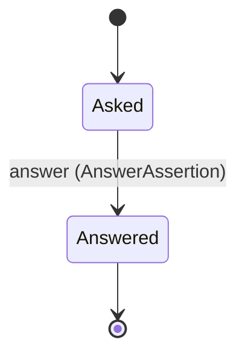

<!-- generated by thalamus-docs, do not edit -->

A caller (a release, a merge request, a test run, a controller) asks whether named signals stayed within baseline over a window, and thalamus answers with a result, not a guess. Unknown is not a pass.

`thalamus.assertion` is one of thalamus's bounded contexts. [All domains](./index.mdx).

## Types

### `Asker`

`thalamus.assertion.Asker` is a record of two fields:

- `kind` — `thalamus.assertion.AskerKind`
- `ref` — `String`

### `AskerKind`

`thalamus.assertion.AskerKind` is one of `release`, `merge_request`, `test_run` and `controller`.

### `AssertionId`

`thalamus.assertion.AssertionId` wraps `String` and is not interchangeable with one: the whole value of naming it separately is the crossings the model then refuses. Every value starts with `asr_`.

### `AssertionResult`

`thalamus.assertion.AssertionResult` is one of `within`, `breach` and `unknown`.

| variant | `passes` |
|---|---|
| `within` | `true` |
| `breach` | `false` |
| `unknown` | `false` |

### `Within`

`thalamus.assertion.Within` is one of `baseline`.

## Entities

An entity is what this context is about: something with an identity that outlives any one request, a shape, and a lifecycle. The lifecycle is exhaustive — a move that is not drawn below is a move this specification does not permit, and that is the only way it says so. Every move is labelled with the command that takes it, because a move nothing can trigger is refused rather than drawn.

### `Assertion`

`thalamus.assertion.Assertion`.

An instance is identified by `assertion_id`, a `thalamus.assertion.AssertionId`. The name is part of the model and not a convention: a view projects the identity under that name, so a projection inventing its own would disagree with the view.

It holds:

- `signals` — `List<thalamus.definition.SignalId>`
- `dims` — `Map<String, thalamus.dimension.DimensionValue>`
- `after` — `Timestamp`
- `horizon` — `Duration`
- `within` — `thalamus.assertion.Within`
- `asker` — `thalamus.assertion.Asker`
- `result` — `Optional<thalamus.assertion.AssertionResult>`, which may be absent
- `worst` — `Optional<thalamus.evaluation.Verdict>`, which may be absent
- `reason` — `Optional<String>`, which may be absent

It references any number of [`thalamus.definition.SignalDefinition`](thalamus-definition.md#signaldefinition), as `signals`, carried by `Assertion.signals`.

Every instance satisfies `((state == Asked and not (defined(result)) and not (defined(worst)) and not (defined(reason))) or (state == Answered and defined(result) and defined(worst)))` — a predicate over this entity's own fields, checked against them rather than stored as a sentence, so an invariant reading something the entity does not have is refused instead of documented.

Its state is a `thalamus.assertion.Assertion.State`, one of `Answered` and `Asked`. That enum is synthesised from the lifecycle rather than declared beside it, so the states a view's filter compares and the states drawn below cannot disagree.

An instance is created in `Asked`. `Answered` is terminal, so an instance may rest there forever. That is declared rather than inferred from having no way out: an entity that cannot leave a state is either finished or stuck, and only its author knows which.

Each move is taken by a declared command outcome, and a move nothing takes is refused as `missing_causation` rather than left as a state change nobody can trigger:

- `answer` — taken by `thalamus.assertion.AnswerAssertion` on its `answered` outcome

An instance is brought into existence by `thalamus.assertion.AskAssertion` on its `asked` outcome.

Illegal transitions are illegal by absence: no rule forbids them, there is simply no arrow, because a rule would be a second place for the same truth to live. A diagram cannot show an absence, so the pairs it does not connect are listed here, derived from the same transitions — anything named below is a move this specification does not permit.

- `Answered` may not become `Asked`

Two views project it: [`Assertions`](#assertions) and [`OpenAssertions`](#openassertions).

## Views

A view is what the outside world is promised it can observe. Each one says which instances it contains and how soon it reflects a command that has already returned, because "you can read this" without "how soon" is the promise every flaky suite is built on.

### `Assertions`

`thalamus.assertion.Assertions`, shown to a person as "Assertions" and called `assertions` on the wire.

It reads [`Assertion`](#assertion).

It contains every instance of that entity: no filter narrows it, which is a decision somebody made and not a line somebody omitted.

It exposes:

- `assertion_id` — `thalamus.assertion.AssertionId`
- `signals` — `List<thalamus.definition.SignalId>`
- `dims` — `Map<String, thalamus.dimension.DimensionValue>`
- `after` — `Timestamp`
- `horizon` — `Duration`
- `within` — `thalamus.assertion.Within`
- `asker` — `thalamus.assertion.Asker`
- `result` — `Optional<thalamus.assertion.AssertionResult>`, which may be absent
- `worst` — `Optional<thalamus.evaluation.Verdict>`, which may be absent
- `reason` — `Optional<String>`, which may be absent
- `state` — `thalamus.assertion.Assertion.State`

It declares no order, so the rows come back in whatever order the implementation has, and two reads may disagree.

**Read-your-writes**: it is current the moment the command that changed it returns. A caller that has just created an invoice and cannot see it in here has been told a lie about what it did.

A generated scenario asserts it once, immediately after the command: a view promising this and not keeping the promise has to fail the suite rather than be retried until it passes.

### `OpenAssertions`

`thalamus.assertion.OpenAssertions`, shown to a person as "Open assertions" and called `open` on the wire.

It reads [`Assertion`](#assertion).

It contains the instances where `state == Asked` holds, and only those — so an instance a caller cannot find in here has been filtered out rather than lost.

It exposes:

- `assertion_id` — `thalamus.assertion.AssertionId`
- `signals` — `List<thalamus.definition.SignalId>`
- `after` — `Timestamp`
- `horizon` — `Duration`
- `asker` — `thalamus.assertion.Asker`

It declares no order, so the rows come back in whatever order the implementation has, and two reads may disagree.

**Read-your-writes**: it is current the moment the command that changed it returns. A caller that has just created an invoice and cannot see it in here has been told a lie about what it did.

A generated scenario asserts it once, immediately after the command: a view promising this and not keeping the promise has to fail the suite rather than be retried until it passes.

## Commands

### `AnswerAssertion`

`thalamus.assertion.AnswerAssertion`, shown to a person as "Answer an assertion" and called `answer` on the wire.

It takes:

- `assertion_id` — `thalamus.assertion.AssertionId`
- `result` — `thalamus.assertion.AssertionResult`
- `worst` — `thalamus.evaluation.Verdict`
- `reason` — `Optional<String>`, which may be absent

It has five outcomes.

**`reason-missing`** — breach or unknown came without a reason; nothing was answered. Taken when `(result != within and not (defined(reason)))` holds of the input. No entity in this specification changes. It reports `thalamus.assertion.ReasonRequired`, carrying `result`. It emits nothing. A test reaches it by constructing an input that satisfies that condition.

**`contradicts-verdict`** — The result and the worst verdict disagree; nothing was answered. Taken when `((result == breach and worst in [OK, N_A, UNKNOWN]) or (result != breach and worst in [WARN, CRIT]) or (result == within and worst == UNKNOWN))` holds of the input. No entity in this specification changes. It reports `thalamus.assertion.ResultContradictsVerdict`, carrying `result` and `worst`. It emits nothing. A test reaches it by constructing an input that satisfies that condition.

**`answered`** — The assertion is answered; the asker reads the result, and only within passes. The default branch, taken when no other outcome's condition matched. It moves a `thalamus.assertion.Assertion` from `Asked` to `Answered`, along the declared move `answer`. The instance is the one named by the input field `assertion_id`. It emits `thalamus.assertion.AssertionAnswered`. It sets `result` from `input.result`, `worst` from `input.worst` and `reason` from `input.reason`. A test reaches it by constructing an input that satisfies no other outcome's condition.

**`wrong-state`** — The assertion is already answered; nothing changed. Taken when the subject is resting in a state none of this command's moves start from — a `thalamus.assertion.Assertion` in `Answered`, which is what is left of the lifecycle once this command's own moves are taken away. The document lists none of it. No entity in this specification changes. It reports `thalamus.assertion.AssertionStateConflict`, carrying `current`. It emits nothing. A test reaches it by driving an instance into one of those states and then issuing the command, because no input selects this branch.

**`no-such-assertion`** — No assertion has this id; nothing changed. Taken when the identity the command names is one no record carries, before any other answer for it. No entity in this specification changes. It reports `thalamus.assertion.UnknownAssertion`, carrying `assertion_id`. It emits nothing. A test reaches it by sending an identity no record carries, arranging nothing.

### `AskAssertion`

`thalamus.assertion.AskAssertion`, shown to a person as "Ask an assertion" and called `ask` on the wire.

It takes:

- `signals` — `List<thalamus.definition.SignalId>`
- `dims` — `Map<String, thalamus.dimension.DimensionValue>`
- `after` — `Timestamp`
- `horizon` — `Duration`
- `within` — `thalamus.assertion.Within`
- `asker` — `thalamus.assertion.Asker`

It has two outcomes.

**`no-signals`** — No signal was named; nothing was asked. Taken when `signals.count == 0` holds of the input. No entity in this specification changes. It reports `thalamus.assertion.NoSignals`. It emits nothing. A test reaches it by constructing an input that satisfies that condition.

**`asked`** — The assertion is open and its id returned; it is answered once its horizon has passed. The default branch, taken when no other outcome's condition matched. It creates a `thalamus.assertion.Assertion`, which starts in `Asked`. The new instance's identity is published as `assertion_id` on `thalamus.assertion.AssertionAsked`. It emits `thalamus.assertion.AssertionAsked`. It sets `signals` from `input.signals`, `dims` from `input.dims`, `after` from `input.after`, `horizon` from `input.horizon`, `within` from `input.within` and `asker` from `input.asker`. A test reaches it by constructing an input that satisfies no other outcome's condition.

## Events

### `AssertionAnswered`

`thalamus.assertion.AssertionAnswered`.

It carries:

- `assertion_id` — `thalamus.assertion.AssertionId`
- `asker` — `thalamus.assertion.Asker`
- `result` — `thalamus.assertion.AssertionResult`
- `worst` — `thalamus.evaluation.Verdict`

Emitted by `thalamus.assertion.AnswerAssertion` on its `answered` outcome.

Nothing in this system reacts to it.

### `AssertionAsked`

`thalamus.assertion.AssertionAsked`.

It carries:

- `assertion_id` — `thalamus.assertion.AssertionId`
- `asker` — `thalamus.assertion.Asker`

Emitted by `thalamus.assertion.AskAssertion` on its `asked` outcome.

Nothing in this system reacts to it.

## Errors

### `AssertionStateConflict`

The assertion is already answered; nothing changed.

It carries:

- `current` — `thalamus.assertion.Assertion.State`

Reported by `thalamus.assertion.AnswerAssertion` on its `wrong-state` outcome.

### `NoSignals`

An assertion names at least one signal; none was named, so nothing was asked.

It carries nothing beyond its name, so a caller can tell what went wrong and not which value caused it.

Reported by `thalamus.assertion.AskAssertion` on its `no-signals` outcome.

### `ReasonRequired`

A breach or unknown result carries a reason; none was given, so nothing was answered.

It carries:

- `result` — `thalamus.assertion.AssertionResult`

Reported by `thalamus.assertion.AnswerAssertion` on its `reason-missing` outcome.

### `ResultContradictsVerdict`

breach goes with a worst verdict of WARN or CRIT and only then, and within never goes with UNKNOWN; the answer broke that, so nothing was answered.

It carries:

- `result` — `thalamus.assertion.AssertionResult`
- `worst` — `thalamus.evaluation.Verdict`

Reported by `thalamus.assertion.AnswerAssertion` on its `contradicts-verdict` outcome.

### `UnknownAssertion`

No assertion has this id; nothing changed.

It carries:

- `assertion_id` — `thalamus.assertion.AssertionId`

Reported by `thalamus.assertion.AnswerAssertion` on its `no-such-assertion` outcome.

## Actors

An actor is who may ask this context for something. Every grant below points at a command this specification declares — a grant is a resolved reference, so "may invoke" something nobody wrote is not a permission this model can express, and an authorisation that authorises nothing cannot ship quietly.

### `Answerer`

`thalamus.assertion.Answerer`.

It may invoke [`AnswerAssertion`](#answerassertion).

### `Caller`

`thalamus.assertion.Caller`.

It may invoke [`AskAssertion`](#askassertion).

---

Generated from thalamus v1 · model digest `51d971079fa66242e2a2f34142dbe44422e1204f980cec980f14fbeb58009d94` · contract digest `slice-sha256/2:cf97bbe660216eecfc11ed559bdc618f2e3ca6e3b8d264491be6601fe1e15a2c`. Do not edit this file; change the specification and regenerate it with `task generate`.
