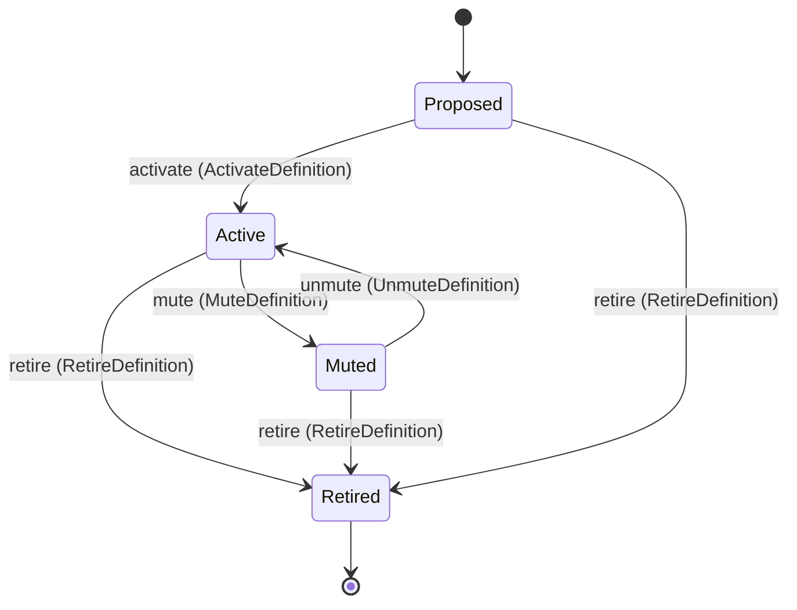

<!-- generated by thalamus-docs, do not edit -->

What is measured and how. One copy of every threshold lives here and nowhere else.

`thalamus.definition` is one of thalamus's bounded contexts. [All domains](./index.mdx).

## Types

### `AdapterId`

`thalamus.definition.AdapterId` wraps `String` and is not interchangeable with one: the whole value of naming it separately is the crossings the model then refuses. Its characters are drawn from `abcdefghijklmnopqrstuvwxyz0123456789_`.

### `Author`

`thalamus.definition.Author` wraps `String` and is not interchangeable with one: the whole value of naming it separately is the crossings the model then refuses.

### `BaselineKind`

`thalamus.definition.BaselineKind` is one of `offset_1d`, `offset_7d`, `pooled`, `higher_of`, `lower_of`, `same_slot_median_4w`, `rolling_median` and `fixed`.

### `ConnectionId`

`thalamus.definition.ConnectionId` wraps `String` and is not interchangeable with one: the whole value of naming it separately is the crossings the model then refuses. Its characters are drawn from `abcdefghijklmnopqrstuvwxyzABCDEFGHIJKLMNOPQRSTUVWXYZ0123456789_-.:/`.

### `DenominatorSpec`

`thalamus.definition.DenominatorSpec` is a record of three fields:

- `unit` — `thalamus.definition.Unit`
- `min_n` — `Integer`
- `since` — `String`

### `EvaluationSpec`

`thalamus.definition.EvaluationSpec` is a record of eight fields:

- `rule` — `thalamus.definition.RuleId`
- `baselines` — `List<thalamus.definition.BaselineKind>`
- `warn` — `Optional<thalamus.definition.Threshold>`, which may be absent
- `crit` — `Optional<thalamus.definition.Threshold>`, which may be absent
- `min_trend_window` — `Optional<Duration>`, which may be absent
- `fixed` — `Optional<Decimal>`, which may be absent
- `rolling_n` — `Optional<Integer>`, which may be absent
- `mapping` — `Optional<Map<String, thalamus.evaluation.Verdict>>`, which may be absent

### `ExtractorId`

`thalamus.definition.ExtractorId` wraps `String` and is not interchangeable with one: the whole value of naming it separately is the crossings the model then refuses.

### `Family`

`thalamus.definition.Family` wraps `String` and is not interchangeable with one: the whole value of naming it separately is the crossings the model then refuses. Its characters are drawn from `abcdefghijklmnopqrstuvwxyz0123456789_`.

### `History`

`thalamus.definition.History` is one of `source` and `store`.

### `Links`

`thalamus.definition.Links` is a record of two fields:

- `components` — `List<String>`
- `issues` — `List<String>`

### `Owner`

`thalamus.definition.Owner` wraps `String` and is not interchangeable with one: the whole value of naming it separately is the crossings the model then refuses.

### `Persistence`

`thalamus.definition.Persistence` is a record of three fields:

- `k` — `Integer`
- `k_crit` — `Integer`
- `m` — `Integer`

### `QueryText`

`thalamus.definition.QueryText` wraps `String` and is not interchangeable with one: the whole value of naming it separately is the crossings the model then refuses.

### `RuleId`

`thalamus.definition.RuleId` wraps `String` and is not interchangeable with one: the whole value of naming it separately is the crossings the model then refuses.

### `SignalId`

`thalamus.definition.SignalId` wraps `String` and is not interchangeable with one: the whole value of naming it separately is the crossings the model then refuses. Its characters are drawn from `abcdefghijklmnopqrstuvwxyz0123456789_.`.

### `SignalKind`

`thalamus.definition.SignalKind` is one of `gauge`, `counter_increase`, `ratio`, `instant` and `count_of_cases`.

### `Source`

`thalamus.definition.Source` is a record of two fields:

- `adapter` — `thalamus.definition.AdapterId`
- `connection` — `thalamus.definition.ConnectionId`

### `Threshold`

`thalamus.definition.Threshold` is a record of three fields:

- `x` — `Optional<Decimal>`, which may be absent
- `abs` — `Optional<Decimal>`, which may be absent
- `min_events` — `Optional<Integer>`, which may be absent

### `Unit`

`thalamus.definition.Unit` wraps `String` and is not interchangeable with one: the whole value of naming it separately is the crossings the model then refuses. Its characters are drawn from `!"#$%&'()*+,-./0123456789:;<=>?@ABCDEFGHIJKLMNOPQRSTUVWXYZ[\]^_`abcdefghijklmnopqrstuvwxyz{|}~`.

## Entities

An entity is what this context is about: something with an identity that outlives any one request, a shape, and a lifecycle. The lifecycle is exhaustive — a move that is not drawn below is a move this specification does not permit, and that is the only way it says so. Every move is labelled with the command that takes it, because a move nothing can trigger is refused rather than drawn.

### `SignalDefinition`

`thalamus.definition.SignalDefinition`.

An instance is identified by `signal_id`, a `thalamus.definition.SignalId`. The name is part of the model and not a convention: a view projects the identity under that name, so a projection inventing its own would disagree with the view.

It holds:

- `title` — `String`
- `family` — `thalamus.definition.Family`
- `kind` — `thalamus.definition.SignalKind`
- `unit` — `Optional<thalamus.definition.Unit>`, which may be absent
- `dimensions` — `Optional<List<thalamus.dimension.DimensionKey>>`, which may be absent
- `source` — `thalamus.definition.Source`
- `extractor` — `thalamus.definition.ExtractorId`
- `query` — `Map<String, thalamus.definition.QueryText>`
- `window` — `Duration`
- `cadence` — `Duration`
- `history` — `thalamus.definition.History`
- `denominator` — `Optional<thalamus.definition.DenominatorSpec>`, which may be absent
- `evaluation` — `thalamus.definition.EvaluationSpec`
- `persistence` — `Optional<thalamus.definition.Persistence>`, which may be absent
- `objective` — `Optional<Json>`, which may be absent
- `owner` — `Optional<thalamus.definition.Owner>`, which may be absent
- `links` — `thalamus.definition.Links`
- `rev` — `Integer`
- `revised_at` — `Timestamp`
- `revised_by` — `thalamus.definition.Author`
- `mute_reason` — `Optional<String>`, which may be absent
- `mute_until` — `Optional<Timestamp>`, which may be absent

It declares no relation to another entity, and no other entity names it.

Every instance satisfies `rev >= 1`, `(state == Proposed or state == Retired or (defined(unit) and defined(dimensions) and defined(denominator) and defined(owner)))` and `((state == Muted and defined(mute_reason) and defined(mute_until)) or (state != Muted and not (defined(mute_reason)) and not (defined(mute_until))))` — a predicate over this entity's own fields, checked against them rather than stored as a sentence, so an invariant reading something the entity does not have is refused instead of documented.

Its state is a `thalamus.definition.SignalDefinition.State`, one of `Active`, `Muted`, `Proposed` and `Retired`. That enum is synthesised from the lifecycle rather than declared beside it, so the states a view's filter compares and the states drawn below cannot disagree.

An instance is created in `Proposed`. `Retired` is terminal, so an instance may rest there forever. That is declared rather than inferred from having no way out: an entity that cannot leave a state is either finished or stuck, and only its author knows which.

Each move is taken by a declared command outcome, and a move nothing takes is refused as `missing_causation` rather than left as a state change nobody can trigger:

- `activate` — taken by `thalamus.definition.ActivateDefinition` on its `activated` outcome
- `mute` — taken by `thalamus.definition.MuteDefinition` on its `muted` outcome
- `unmute` — taken by `thalamus.definition.UnmuteDefinition` on its `unmuted` outcome
- `retire` — taken by `thalamus.definition.RetireDefinition` on its `retired` outcome

An instance is brought into existence by `thalamus.definition.ProposeDefinition` on its `proposed` outcome.

Illegal transitions are illegal by absence: no rule forbids them, there is simply no arrow, because a rule would be a second place for the same truth to live. A diagram cannot show an absence, so the pairs it does not connect are listed here, derived from the same transitions — anything named below is a move this specification does not permit.

- `Active` may not become `Proposed`
- `Muted` may not become `Proposed`
- `Proposed` may not become `Muted`
- `Retired` may not become `Active`
- `Retired` may not become `Muted`
- `Retired` may not become `Proposed`

Two views project it: [`ActiveDefinitions`](#activedefinitions) and [`Definitions`](#definitions).

## Views

A view is what the outside world is promised it can observe. Each one says which instances it contains and how soon it reflects a command that has already returned, because "you can read this" without "how soon" is the promise every flaky suite is built on.

### `ActiveDefinitions`

`thalamus.definition.ActiveDefinitions`, shown to a person as "Active definitions" and called `active` on the wire.

It reads [`SignalDefinition`](#signaldefinition).

It contains the instances where `state == Active` holds, and only those — so an instance a caller cannot find in here has been filtered out rather than lost.

It exposes:

- `signal_id` — `thalamus.definition.SignalId`
- `title` — `String`
- `family` — `thalamus.definition.Family`
- `kind` — `thalamus.definition.SignalKind`
- `unit` — `Optional<thalamus.definition.Unit>`, which may be absent
- `dimensions` — `Optional<List<thalamus.dimension.DimensionKey>>`, which may be absent
- `source` — `thalamus.definition.Source`
- `cadence` — `Duration`
- `owner` — `Optional<thalamus.definition.Owner>`, which may be absent
- `rev` — `Integer`

It declares no order, so the rows come back in whatever order the implementation has, and two reads may disagree.

**Read-your-writes**: it is current the moment the command that changed it returns. A caller that has just created an invoice and cannot see it in here has been told a lie about what it did.

A generated scenario asserts it once, immediately after the command: a view promising this and not keeping the promise has to fail the suite rather than be retried until it passes.

### `Definitions`

`thalamus.definition.Definitions`, shown to a person as "Definitions" and called `definitions` on the wire.

It reads [`SignalDefinition`](#signaldefinition).

It contains every instance of that entity: no filter narrows it, which is a decision somebody made and not a line somebody omitted.

It exposes:

- `signal_id` — `thalamus.definition.SignalId`
- `title` — `String`
- `family` — `thalamus.definition.Family`
- `kind` — `thalamus.definition.SignalKind`
- `unit` — `Optional<thalamus.definition.Unit>`, which may be absent
- `dimensions` — `Optional<List<thalamus.dimension.DimensionKey>>`, which may be absent
- `source` — `thalamus.definition.Source`
- `extractor` — `thalamus.definition.ExtractorId`
- `query` — `Map<String, thalamus.definition.QueryText>`
- `window` — `Duration`
- `cadence` — `Duration`
- `history` — `thalamus.definition.History`
- `denominator` — `Optional<thalamus.definition.DenominatorSpec>`, which may be absent
- `objective` — `Optional<Json>`, which may be absent
- `owner` — `Optional<thalamus.definition.Owner>`, which may be absent
- `links` — `thalamus.definition.Links`
- `rev` — `Integer`
- `revised_at` — `Timestamp`
- `revised_by` — `thalamus.definition.Author`
- `mute_reason` — `Optional<String>`, which may be absent
- `mute_until` — `Optional<Timestamp>`, which may be absent
- `state` — `thalamus.definition.SignalDefinition.State`

It declares no order, so the rows come back in whatever order the implementation has, and two reads may disagree.

**Read-your-writes**: it is current the moment the command that changed it returns. A caller that has just created an invoice and cannot see it in here has been told a lie about what it did.

A generated scenario asserts it once, immediately after the command: a view promising this and not keeping the promise has to fail the suite rather than be retried until it passes.

## Commands

### `ActivateDefinition`

`thalamus.definition.ActivateDefinition`, shown to a person as "Activate a definition" and called `activate` on the wire.

It takes:

- `signal_id` — `thalamus.definition.SignalId`

It has four outcomes.

**`incomplete`** — Unit, dimensions, denominator or owner is missing; the definition stays Proposed. Taken when the existing subject's stored fields satisfy `(not (defined(unit)) or not (defined(dimensions)) or not (defined(denominator)) or not (defined(owner)))`. No entity in this specification changes. It reports `thalamus.definition.IncompleteDefinition`, carrying `signal_id`. It emits nothing. A test establishes and independently observes the subject enum fact before selecting this branch.

**`activated`** — The definition is Active; the scheduler samples it on its cadence. The default branch, taken when no other outcome's condition matched. It moves a `thalamus.definition.SignalDefinition` from `Proposed` to `Active`, along the declared move `activate`. The instance is the one named by the input field `signal_id`. It emits `thalamus.definition.DefinitionActivated`. A test reaches it by constructing an input that satisfies no other outcome's condition.

**`wrong-state`** — The definition is not Proposed; nothing changed. Taken when the subject is resting in a state none of this command's moves start from — a `thalamus.definition.SignalDefinition` in `Active`, `Muted` and `Retired`, which is what is left of the lifecycle once this command's own moves are taken away. The document lists none of it. No entity in this specification changes. It reports `thalamus.definition.DefinitionStateConflict`, carrying `current`. It emits nothing. A test reaches it by driving an instance into one of those states and then issuing the command, because no input selects this branch.

**`no-such-definition`** — No definition has this id; nothing changed. Taken when the identity the command names is one no record carries, before any other answer for it. No entity in this specification changes. It reports `thalamus.definition.UnknownDefinition`, carrying `signal_id`. It emits nothing. A test reaches it by sending an identity no record carries, arranging nothing.

### `MuteDefinition`

`thalamus.definition.MuteDefinition`, shown to a person as "Mute a definition" and called `mute` on the wire.

It takes:

- `signal_id` — `thalamus.definition.SignalId`
- `reason` — `String`
- `until` — `Timestamp`

It has four outcomes.

**`expiry-passed`** — The expiry is not in the future; nothing was muted. Taken when `until <= now` holds of the input. No entity in this specification changes. It reports `thalamus.definition.MuteExpiryPassed`, carrying `until`. It emits nothing. A test reaches it by constructing an input that satisfies that condition.

**`muted`** — The definition is Muted and carries its reason and expiry. The default branch, taken when no other outcome's condition matched. It moves a `thalamus.definition.SignalDefinition` from `Active` to `Muted`, along the declared move `mute`. The instance is the one named by the input field `signal_id`. It emits `thalamus.definition.DefinitionMuted`. It sets `mute_reason` from `input.reason` and `mute_until` from `input.until`. A test reaches it by constructing an input that satisfies no other outcome's condition.

**`wrong-state`** — The definition is not Active; nothing changed. Taken when the subject is resting in a state none of this command's moves start from — a `thalamus.definition.SignalDefinition` in `Muted`, `Proposed` and `Retired`, which is what is left of the lifecycle once this command's own moves are taken away. The document lists none of it. No entity in this specification changes. It reports `thalamus.definition.DefinitionStateConflict`, carrying `current`. It emits nothing. A test reaches it by driving an instance into one of those states and then issuing the command, because no input selects this branch.

**`no-such-definition`** — No definition has this id; nothing changed. Taken when the identity the command names is one no record carries, before any other answer for it. No entity in this specification changes. It reports `thalamus.definition.UnknownDefinition`, carrying `signal_id`. It emits nothing. A test reaches it by sending an identity no record carries, arranging nothing.

### `ProposeDefinition`

`thalamus.definition.ProposeDefinition`, shown to a person as "Propose a definition" and called `propose` on the wire.

It takes:

- `signal_id` — `thalamus.definition.SignalId`
- `title` — `String`
- `family` — `thalamus.definition.Family`
- `kind` — `thalamus.definition.SignalKind`
- `unit` — `Optional<thalamus.definition.Unit>`, which may be absent
- `dimensions` — `Optional<List<thalamus.dimension.DimensionKey>>`, which may be absent
- `source` — `thalamus.definition.Source`
- `extractor` — `thalamus.definition.ExtractorId`
- `query` — `Map<String, thalamus.definition.QueryText>`
- `window` — `Duration`
- `cadence` — `Duration`
- `history` — `thalamus.definition.History`
- `denominator` — `Optional<thalamus.definition.DenominatorSpec>`, which may be absent
- `evaluation` — `thalamus.definition.EvaluationSpec`
- `persistence` — `Optional<thalamus.definition.Persistence>`, which may be absent
- `objective` — `Optional<Json>`, which may be absent
- `owner` — `Optional<thalamus.definition.Owner>`, which may be absent
- `links` — `thalamus.definition.Links`
- `author` — `thalamus.definition.Author`

It has 12 outcomes.

**`host-not-local`** — A host definition named a connection other than local; nothing was proposed. Taken when `(source.adapter == host and source.connection != local)` holds of the input. No entity in this specification changes. It reports `thalamus.definition.HostConnectionNotLocal`, carrying `signal_id`. It emits nothing. A test reaches it by constructing an input that satisfies that condition.

**`instant-not-fixed`** — An instant signal declared a baseline other than fixed; nothing was proposed. Taken when `(kind == instant and exists b in evaluation.baselines: (b != fixed))` holds of the input. No entity in this specification changes. It reports `thalamus.definition.InstantNeedsFixedBaseline`, carrying `signal_id`. It emits nothing. A test reaches it by constructing an input that satisfies that condition.

**`rolling-n-missing`** — A rolling_median baseline was declared without evaluation.rolling_n; nothing was proposed. Taken when `(exists b in evaluation.baselines: (b == rolling_median) and not (defined(evaluation.rolling_n)))` holds of the input. No entity in this specification changes. It reports `thalamus.definition.RollingWindowMissing`, carrying `signal_id`. It emits nothing. A test reaches it by constructing an input that satisfies that condition.

**`rolling-n-unused`** — evaluation.rolling_n was declared without a rolling_median baseline to read it; nothing was proposed. Taken when `(defined(evaluation.rolling_n) and forall b in evaluation.baselines: (b != rolling_median))` holds of the input. No entity in this specification changes. It reports `thalamus.definition.RollingWindowUnused`, carrying `signal_id`. It emits nothing. A test reaches it by constructing an input that satisfies that condition.

**`fixed-number-missing`** — A fixed baseline was declared without evaluation.fixed; nothing was proposed. Taken when `(exists b in evaluation.baselines: (b == fixed) and not (defined(evaluation.fixed)))` holds of the input. No entity in this specification changes. It reports `thalamus.definition.FixedNumberMissing`, carrying `signal_id`. It emits nothing. A test reaches it by constructing an input that satisfies that condition.

**`fixed-number-unused`** — evaluation.fixed was declared without a fixed baseline to read it; nothing was proposed. Taken when `(defined(evaluation.fixed) and forall b in evaluation.baselines: (b != fixed))` holds of the input. No entity in this specification changes. It reports `thalamus.definition.FixedNumberUnused`, carrying `signal_id`. It emits nothing. A test reaches it by constructing an input that satisfies that condition.

**`persistence-below-one`** — persistence k, k_crit or m is below 1, settling or clearing on no evaluation; nothing was proposed. Taken when `(persistence.k < 1 or persistence.k_crit < 1 or persistence.m < 1)` holds of the input. No entity in this specification changes. It reports `thalamus.definition.PersistenceTooSmall`, carrying `signal_id`. It emits nothing. A test reaches it by constructing an input that satisfies that condition.

**`mapping-missing`** — The rule producer_mapped was named without evaluation.mapping; nothing was proposed. Taken when `(evaluation.rule == producer_mapped and not (defined(evaluation.mapping)))` holds of the input. No entity in this specification changes. It reports `thalamus.definition.MappingMissing`, carrying `signal_id`. It emits nothing. A test reaches it by constructing an input that satisfies that condition.

**`mapping-unused`** — evaluation.mapping was declared under a rule other than producer_mapped; nothing was proposed. Taken when `(defined(evaluation.mapping) and evaluation.rule != producer_mapped)` holds of the input. No entity in this specification changes. It reports `thalamus.definition.MappingUnused`, carrying `signal_id`. It emits nothing. A test reaches it by constructing an input that satisfies that condition.

**`thresholds-unused`** — A warn or crit line was declared under producer_mapped; nothing was proposed. Taken when `(evaluation.rule == producer_mapped and (defined(evaluation.warn) or defined(evaluation.crit)))` holds of the input. No entity in this specification changes. It reports `thalamus.definition.ThresholdsUnused`, carrying `signal_id`. It emits nothing. A test reaches it by constructing an input that satisfies that condition.

**`proposed`** — The definition exists at revision 1 and is Proposed. The default branch, taken when no other outcome's condition matched. It creates a `thalamus.definition.SignalDefinition`, which starts in `Proposed`. The new instance's identity is published as `signal_id` on `thalamus.definition.DefinitionProposed`. It emits `thalamus.definition.DefinitionProposed`. It sets `title` from `input.title`, `family` from `input.family`, `kind` from `input.kind`, `unit` from `input.unit`, `dimensions` from `input.dimensions`, `source` from `input.source`, `extractor` from `input.extractor`, `query` from `input.query`, `window` from `input.window`, `cadence` from `input.cadence`, `history` from `input.history`, `denominator` from `input.denominator`, `evaluation` from `input.evaluation`, `persistence` from `input.persistence`, `objective` from `input.objective`, `owner` from `input.owner`, `links` from `input.links`, `rev` from `"1"`, `revised_at` from `implementation-generated` and `revised_by` from `input.author`. A test reaches it by constructing an input that satisfies no other outcome's condition.

**`already-defined`** — The id is taken; nothing changed. Taken when a record already carries the identity the command's creating branch would create, and no input-guarded refusal applies. No entity in this specification changes. It reports `thalamus.definition.DefinitionExists`, carrying `signal_id`. It emits nothing. A test reaches it by sending the command twice with one identity: the first call creates the record, the second is answered by this branch.

### `RetireDefinition`

`thalamus.definition.RetireDefinition`, shown to a person as "Retire a definition" and called `retire` on the wire.

It takes:

- `signal_id` — `thalamus.definition.SignalId`

It has three outcomes.

**`retired`** — The definition is Retired; it is never sampled again. The default branch, taken when no other outcome's condition matched. It moves a `thalamus.definition.SignalDefinition` from `Active`, `Muted` and `Proposed` to `Retired`, along the declared move `retire`. The instance is the one named by the input field `signal_id`. It emits `thalamus.definition.DefinitionRetired`. It sets `mute_reason` cleared and `mute_until` cleared. A test reaches it by constructing an input that satisfies no other outcome's condition.

**`wrong-state`** — The definition is already Retired; nothing changed. Taken when the subject is resting in a state none of this command's moves start from — a `thalamus.definition.SignalDefinition` in `Retired`, which is what is left of the lifecycle once this command's own moves are taken away. The document lists none of it. No entity in this specification changes. It reports `thalamus.definition.DefinitionStateConflict`, carrying `current`. It emits nothing. A test reaches it by driving an instance into one of those states and then issuing the command, because no input selects this branch.

**`no-such-definition`** — No definition has this id; nothing changed. Taken when the identity the command names is one no record carries, before any other answer for it. No entity in this specification changes. It reports `thalamus.definition.UnknownDefinition`, carrying `signal_id`. It emits nothing. A test reaches it by sending an identity no record carries, arranging nothing.

### `ReviseDefinition`

`thalamus.definition.ReviseDefinition`, shown to a person as "Revise a definition" and called `revise` on the wire.

It takes:

- `signal_id` — `thalamus.definition.SignalId`
- `title` — `String`
- `family` — `thalamus.definition.Family`
- `kind` — `thalamus.definition.SignalKind`
- `unit` — `thalamus.definition.Unit`
- `dimensions` — `List<thalamus.dimension.DimensionKey>`
- `source` — `thalamus.definition.Source`
- `extractor` — `thalamus.definition.ExtractorId`
- `query` — `Map<String, thalamus.definition.QueryText>`
- `window` — `Duration`
- `cadence` — `Duration`
- `history` — `thalamus.definition.History`
- `denominator` — `thalamus.definition.DenominatorSpec`
- `evaluation` — `thalamus.definition.EvaluationSpec`
- `persistence` — `Optional<thalamus.definition.Persistence>`, which may be absent
- `objective` — `Optional<Json>`, which may be absent
- `owner` — `thalamus.definition.Owner`
- `links` — `thalamus.definition.Links`
- `author` — `thalamus.definition.Author`

It has 13 outcomes.

**`retired`** — The definition is retired; nothing changed. Taken when the existing subject's stored fields satisfy `state == Retired`. No entity in this specification changes. It reports `thalamus.definition.RetiredDefinition`, carrying `signal_id`. It emits nothing. A test establishes and independently observes the subject enum fact before selecting this branch.

**`host-not-local`** — A host definition named a connection other than local; nothing changed. Taken when `(source.adapter == host and source.connection != local)` holds of the input. No entity in this specification changes. It reports `thalamus.definition.HostConnectionNotLocal`, carrying `signal_id`. It emits nothing. A test reaches it by constructing an input that satisfies that condition.

**`instant-not-fixed`** — An instant signal declared a baseline other than fixed; nothing changed. Taken when `(kind == instant and exists b in evaluation.baselines: (b != fixed))` holds of the input. No entity in this specification changes. It reports `thalamus.definition.InstantNeedsFixedBaseline`, carrying `signal_id`. It emits nothing. A test reaches it by constructing an input that satisfies that condition.

**`rolling-n-missing`** — A rolling_median baseline was declared without evaluation.rolling_n; nothing changed. Taken when `(exists b in evaluation.baselines: (b == rolling_median) and not (defined(evaluation.rolling_n)))` holds of the input. No entity in this specification changes. It reports `thalamus.definition.RollingWindowMissing`, carrying `signal_id`. It emits nothing. A test reaches it by constructing an input that satisfies that condition.

**`rolling-n-unused`** — evaluation.rolling_n was declared without a rolling_median baseline to read it; nothing changed. Taken when `(defined(evaluation.rolling_n) and forall b in evaluation.baselines: (b != rolling_median))` holds of the input. No entity in this specification changes. It reports `thalamus.definition.RollingWindowUnused`, carrying `signal_id`. It emits nothing. A test reaches it by constructing an input that satisfies that condition.

**`fixed-number-missing`** — A fixed baseline was declared without evaluation.fixed; nothing changed. Taken when `(exists b in evaluation.baselines: (b == fixed) and not (defined(evaluation.fixed)))` holds of the input. No entity in this specification changes. It reports `thalamus.definition.FixedNumberMissing`, carrying `signal_id`. It emits nothing. A test reaches it by constructing an input that satisfies that condition.

**`fixed-number-unused`** — evaluation.fixed was declared without a fixed baseline to read it; nothing changed. Taken when `(defined(evaluation.fixed) and forall b in evaluation.baselines: (b != fixed))` holds of the input. No entity in this specification changes. It reports `thalamus.definition.FixedNumberUnused`, carrying `signal_id`. It emits nothing. A test reaches it by constructing an input that satisfies that condition.

**`persistence-below-one`** — persistence k, k_crit or m is below 1, settling or clearing on no evaluation; nothing changed. Taken when `(persistence.k < 1 or persistence.k_crit < 1 or persistence.m < 1)` holds of the input. No entity in this specification changes. It reports `thalamus.definition.PersistenceTooSmall`, carrying `signal_id`. It emits nothing. A test reaches it by constructing an input that satisfies that condition.

**`mapping-missing`** — The rule producer_mapped was named without evaluation.mapping; nothing changed. Taken when `(evaluation.rule == producer_mapped and not (defined(evaluation.mapping)))` holds of the input. No entity in this specification changes. It reports `thalamus.definition.MappingMissing`, carrying `signal_id`. It emits nothing. A test reaches it by constructing an input that satisfies that condition.

**`mapping-unused`** — evaluation.mapping was declared under a rule other than producer_mapped; nothing changed. Taken when `(defined(evaluation.mapping) and evaluation.rule != producer_mapped)` holds of the input. No entity in this specification changes. It reports `thalamus.definition.MappingUnused`, carrying `signal_id`. It emits nothing. A test reaches it by constructing an input that satisfies that condition.

**`thresholds-unused`** — A warn or crit line was declared under producer_mapped; nothing changed. Taken when `(evaluation.rule == producer_mapped and (defined(evaluation.warn) or defined(evaluation.crit)))` holds of the input. No entity in this specification changes. It reports `thalamus.definition.ThresholdsUnused`, carrying `signal_id`. It emits nothing. A test reaches it by constructing an input that satisfies that condition.

**`revised`** — The body is replaced and rev is one higher; evaluations already recorded keep the rev they name. The default branch, taken when no other outcome's condition matched. It changes a `thalamus.definition.SignalDefinition` without moving it along its lifecycle. The instance is the one named by the input field `signal_id`. It emits `thalamus.definition.DefinitionRevised`. It sets `title` from `input.title`, `family` from `input.family`, `kind` from `input.kind`, `unit` from `input.unit`, `dimensions` from `input.dimensions`, `source` from `input.source`, `extractor` from `input.extractor`, `query` from `input.query`, `window` from `input.window`, `cadence` from `input.cadence`, `history` from `input.history`, `denominator` from `input.denominator`, `evaluation` from `input.evaluation`, `persistence` from `input.persistence`, `objective` from `input.objective`, `owner` from `input.owner`, `links` from `input.links`, `rev` from `its previous value plus 1`, `revised_at` from `implementation-generated` and `revised_by` from `input.author`. A test reaches it by constructing an input that satisfies no other outcome's condition.

**`no-such-definition`** — No definition has this id; nothing changed. Taken when the identity the command names is one no record carries, before any other answer for it. No entity in this specification changes. It reports `thalamus.definition.UnknownDefinition`, carrying `signal_id`. It emits nothing. A test reaches it by sending an identity no record carries, arranging nothing.

### `UnmuteDefinition`

`thalamus.definition.UnmuteDefinition`, shown to a person as "Unmute a definition" and called `unmute` on the wire.

It takes:

- `signal_id` — `thalamus.definition.SignalId`

It has three outcomes.

**`unmuted`** — The definition is Active again and carries no mute. The default branch, taken when no other outcome's condition matched. It moves a `thalamus.definition.SignalDefinition` from `Muted` to `Active`, along the declared move `unmute`. The instance is the one named by the input field `signal_id`. It emits `thalamus.definition.DefinitionUnmuted`. It sets `mute_reason` cleared and `mute_until` cleared. A test reaches it by constructing an input that satisfies no other outcome's condition.

**`wrong-state`** — The definition is not Muted; nothing changed. Taken when the subject is resting in a state none of this command's moves start from — a `thalamus.definition.SignalDefinition` in `Active`, `Proposed` and `Retired`, which is what is left of the lifecycle once this command's own moves are taken away. The document lists none of it. No entity in this specification changes. It reports `thalamus.definition.DefinitionStateConflict`, carrying `current`. It emits nothing. A test reaches it by driving an instance into one of those states and then issuing the command, because no input selects this branch.

**`no-such-definition`** — No definition has this id; nothing changed. Taken when the identity the command names is one no record carries, before any other answer for it. No entity in this specification changes. It reports `thalamus.definition.UnknownDefinition`, carrying `signal_id`. It emits nothing. A test reaches it by sending an identity no record carries, arranging nothing.

## Events

### `DefinitionActivated`

`thalamus.definition.DefinitionActivated`.

It carries:

- `signal_id` — `thalamus.definition.SignalId`

Emitted by `thalamus.definition.ActivateDefinition` on its `activated` outcome.

Nothing in this system reacts to it.

### `DefinitionMuted`

`thalamus.definition.DefinitionMuted`.

It carries:

- `signal_id` — `thalamus.definition.SignalId`
- `reason` — `String`
- `until` — `Timestamp`

Emitted by `thalamus.definition.MuteDefinition` on its `muted` outcome.

Nothing in this system reacts to it.

### `DefinitionProposed`

`thalamus.definition.DefinitionProposed`.

It carries:

- `signal_id` — `thalamus.definition.SignalId`
- `revised_by` — `thalamus.definition.Author`

Emitted by `thalamus.definition.ProposeDefinition` on its `proposed` outcome.

Nothing in this system reacts to it.

### `DefinitionRetired`

`thalamus.definition.DefinitionRetired`.

It carries:

- `signal_id` — `thalamus.definition.SignalId`

Emitted by `thalamus.definition.RetireDefinition` on its `retired` outcome.

Nothing in this system reacts to it.

### `DefinitionRevised`

`thalamus.definition.DefinitionRevised`.

It carries:

- `signal_id` — `thalamus.definition.SignalId`
- `previous_rev` — `Integer`
- `revised_by` — `thalamus.definition.Author`

Emitted by `thalamus.definition.ReviseDefinition` on its `revised` outcome.

Nothing in this system reacts to it.

### `DefinitionUnmuted`

`thalamus.definition.DefinitionUnmuted`.

It carries:

- `signal_id` — `thalamus.definition.SignalId`

Emitted by `thalamus.definition.UnmuteDefinition` on its `unmuted` outcome.

Nothing in this system reacts to it.

## Errors

### `DefinitionExists`

A definition with this id exists; nothing changed.

It carries:

- `signal_id` — `thalamus.definition.SignalId`

Reported by `thalamus.definition.ProposeDefinition` on its `already-defined` outcome.

### `DefinitionStateConflict`

The definition is not in a state this command acts from; nothing changed.

It carries:

- `current` — `thalamus.definition.SignalDefinition.State`

Reported by `thalamus.definition.ActivateDefinition` on its `wrong-state` outcome.

Reported by `thalamus.definition.MuteDefinition` on its `wrong-state` outcome.

Reported by `thalamus.definition.RetireDefinition` on its `wrong-state` outcome.

Reported by `thalamus.definition.UnmuteDefinition` on its `wrong-state` outcome.

### `FixedNumberMissing`

A fixed baseline is the definition's own number, and evaluation.fixed declares none; nothing changed.

It carries:

- `signal_id` — `thalamus.definition.SignalId`

Reported by `thalamus.definition.ProposeDefinition` on its `fixed-number-missing` outcome.

Reported by `thalamus.definition.ReviseDefinition` on its `fixed-number-missing` outcome.

### `FixedNumberUnused`

evaluation.fixed is declared, and no fixed baseline reads it; a threshold nothing reads is not kept, so nothing changed.

It carries:

- `signal_id` — `thalamus.definition.SignalId`

Reported by `thalamus.definition.ProposeDefinition` on its `fixed-number-unused` outcome.

Reported by `thalamus.definition.ReviseDefinition` on its `fixed-number-unused` outcome.

### `HostConnectionNotLocal`

The host adapter reads only the machine thalamus runs on, through the reserved connection local, and another connection was named; nothing changed.

It carries:

- `signal_id` — `thalamus.definition.SignalId`

Reported by `thalamus.definition.ProposeDefinition` on its `host-not-local` outcome.

Reported by `thalamus.definition.ReviseDefinition` on its `host-not-local` outcome.

### `IncompleteDefinition`

An active definition declares unit, dimensions, denominator and owner; at least one is missing, so it stays Proposed.

It carries:

- `signal_id` — `thalamus.definition.SignalId`

Reported by `thalamus.definition.ActivateDefinition` on its `incomplete` outcome.

### `InstantNeedsFixedBaseline`

A signal of kind instant is graded against a fixed baseline only; another baseline was declared, so nothing changed.

It carries:

- `signal_id` — `thalamus.definition.SignalId`

Reported by `thalamus.definition.ProposeDefinition` on its `instant-not-fixed` outcome.

Reported by `thalamus.definition.ReviseDefinition` on its `instant-not-fixed` outcome.

### `MappingMissing`

The rule producer_mapped grades a producer's own value through evaluation.mapping, and the definition declares no mapping onto OK, WARN, CRIT or UNKNOWN; nothing changed.

It carries:

- `signal_id` — `thalamus.definition.SignalId`

Reported by `thalamus.definition.ProposeDefinition` on its `mapping-missing` outcome.

Reported by `thalamus.definition.ReviseDefinition` on its `mapping-missing` outcome.

### `MappingUnused`

evaluation.mapping is declared, and the rule is not producer_mapped, so nothing reads it; a table nothing reads is not kept, so nothing changed.

It carries:

- `signal_id` — `thalamus.definition.SignalId`

Reported by `thalamus.definition.ProposeDefinition` on its `mapping-unused` outcome.

Reported by `thalamus.definition.ReviseDefinition` on its `mapping-unused` outcome.

### `MuteExpiryPassed`

A mute carries an expiry in the future; this one has passed, so nothing was muted.

It carries:

- `until` — `Timestamp`

Reported by `thalamus.definition.MuteDefinition` on its `expiry-passed` outcome.

### `PersistenceTooSmall`

persistence k, k_crit or m is below 1, which settles or clears a verdict on no evaluation; nothing changed.

It carries:

- `signal_id` — `thalamus.definition.SignalId`

Reported by `thalamus.definition.ProposeDefinition` on its `persistence-below-one` outcome.

Reported by `thalamus.definition.ReviseDefinition` on its `persistence-below-one` outcome.

### `RetiredDefinition`

A retired definition takes no revision; nothing changed.

It carries:

- `signal_id` — `thalamus.definition.SignalId`

Reported by `thalamus.definition.ReviseDefinition` on its `retired` outcome.

### `RollingWindowMissing`

A rolling_median baseline is the median of the last N samples, and evaluation.rolling_n declares no N of at least 1; nothing changed.

It carries:

- `signal_id` — `thalamus.definition.SignalId`

Reported by `thalamus.definition.ProposeDefinition` on its `rolling-n-missing` outcome.

Reported by `thalamus.definition.ReviseDefinition` on its `rolling-n-missing` outcome.

### `RollingWindowUnused`

evaluation.rolling_n is declared, and no rolling_median baseline reads it; a threshold nothing reads is not kept, so nothing changed.

It carries:

- `signal_id` — `thalamus.definition.SignalId`

Reported by `thalamus.definition.ProposeDefinition` on its `rolling-n-unused` outcome.

Reported by `thalamus.definition.ReviseDefinition` on its `rolling-n-unused` outcome.

### `ThresholdsUnused`

The rule producer_mapped grades by evaluation.mapping alone, and evaluation.warn or evaluation.crit is declared; a line nothing reads is not kept, so nothing changed.

It carries:

- `signal_id` — `thalamus.definition.SignalId`

Reported by `thalamus.definition.ProposeDefinition` on its `thresholds-unused` outcome.

Reported by `thalamus.definition.ReviseDefinition` on its `thresholds-unused` outcome.

### `UnknownDefinition`

No definition has this id; nothing changed.

It carries:

- `signal_id` — `thalamus.definition.SignalId`

Reported by `thalamus.definition.ActivateDefinition` on its `no-such-definition` outcome.

Reported by `thalamus.definition.MuteDefinition` on its `no-such-definition` outcome.

Reported by `thalamus.definition.RetireDefinition` on its `no-such-definition` outcome.

Reported by `thalamus.definition.ReviseDefinition` on its `no-such-definition` outcome.

Reported by `thalamus.definition.UnmuteDefinition` on its `no-such-definition` outcome.

## Actors

An actor is who may ask this context for something. Every grant below points at a command this specification declares — a grant is a resolved reference, so "may invoke" something nobody wrote is not a permission this model can express, and an authorisation that authorises nothing cannot ship quietly.

### `InstanceOperator`

`thalamus.definition.InstanceOperator`.

It may invoke [`ActivateDefinition`](#activatedefinition), [`MuteDefinition`](#mutedefinition), [`ProposeDefinition`](#proposedefinition), [`RetireDefinition`](#retiredefinition), [`ReviseDefinition`](#revisedefinition) and [`UnmuteDefinition`](#unmutedefinition).

### `Service`

`thalamus.definition.Service`.

It may invoke [`UnmuteDefinition`](#unmutedefinition).

---

Generated from thalamus v1 · model digest `9f981109ead94ade6b2b664c0234683eabf8a4e37dbb57b0fab92ac76ace7832` · contract digest `slice-sha256/2:2ed93385db2228d083563865fb38fb77a0fcaa781f8426800da9b0aa31afe678`. Do not edit this file; change the specification and regenerate it with `task generate`.
