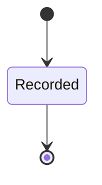

<!-- generated by thalamus-docs, do not edit -->

One verdict over one sample, with the rule and the definition revision that decided it. Kept apart from the sample so a threshold change re-grades history without reading the source again.

`thalamus.evaluation` is one of thalamus's bounded contexts. [All domains](./index.mdx).

## Types

### `Baseline`

`thalamus.evaluation.Baseline` is a record of three fields:

- `kind` — `thalamus.evaluation.BaselineLabel`
- `offsets` — `List<String>`
- `reading` — `thalamus.observation.Reading`

### `BaselineLabel`

`thalamus.evaluation.BaselineLabel` wraps `String` and is not interchangeable with one: the whole value of naming it separately is the crossings the model then refuses. Its characters are drawn from `abcdefghijklmnopqrstuvwxyz0123456789_`.

### `EvaluationId`

`thalamus.evaluation.EvaluationId` wraps `String` and is not interchangeable with one: the whole value of naming it separately is the crossings the model then refuses. Every value starts with `evl_`.

### `Verdict`

`thalamus.evaluation.Verdict` is one of `OK`, `N_A`, `WARN`, `CRIT` and `UNKNOWN`.

| variant | `exit` | `rank` | `scored` |
|---|---|---|---|
| `OK` | `0` | `0` | `true` |
| `N_A` | `0` | `0` | `false` |
| `WARN` | `1` | `2` | `true` |
| `CRIT` | `2` | `3` | `true` |
| `UNKNOWN` | `3` | `1` | `false` |

## Entities

An entity is what this context is about: something with an identity that outlives any one request, a shape, and a lifecycle. The lifecycle is exhaustive — a move that is not drawn below is a move this specification does not permit, and that is the only way it says so. Every move is labelled with the command that takes it, because a move nothing can trigger is refused rather than drawn.

### `SignalEvaluation`

`thalamus.evaluation.SignalEvaluation`.

An instance is identified by `evaluation_id`, a `thalamus.evaluation.EvaluationId`. The name is part of the model and not a convention: a view projects the identity under that name, so a projection inventing its own would disagree with the view.

It holds:

- `sample_id` — `thalamus.observation.SampleId`
- `signal` — `thalamus.definition.SignalId`
- `series` — `thalamus.observation.SeriesKey`
- `dims` — `Map<String, thalamus.dimension.DimensionValue>`
- `ts` — `Timestamp`
- `definition_rev` — `Integer`
- `verdict` — `thalamus.evaluation.Verdict`
- `prev` — `Optional<thalamus.evaluation.Verdict>`, which may be absent
- `score` — `Optional<Decimal>`, which may be absent
- `baseline` — `Optional<thalamus.evaluation.Baseline>`, which may be absent
- `reason` — `Optional<String>`, which may be absent

It references at most one [`thalamus.observation.SignalSample`](thalamus-observation.md#signalsample), as `sample`, carried by `SignalEvaluation.sample_id`. It references at most one [`thalamus.definition.SignalDefinition`](thalamus-definition.md#signaldefinition), as `definition`, carried by `SignalEvaluation.signal`.

Every instance satisfies `definition_rev >= 1`, `(verdict == OK or defined(reason))` and `(verdict.scored == true or not (defined(score)))` — a predicate over this entity's own fields, checked against them rather than stored as a sentence, so an invariant reading something the entity does not have is refused instead of documented.

Its state is a `thalamus.evaluation.SignalEvaluation.State`, one of `Recorded`. That enum is synthesised from the lifecycle rather than declared beside it, so the states a view's filter compares and the states drawn below cannot disagree.

An instance is created in `Recorded`. `Recorded` is terminal, so an instance may rest there forever. That is declared rather than inferred from having no way out: an entity that cannot leave a state is either finished or stuck, and only its author knows which.

It declares no moves, so nothing changes its state once it exists.

It has one state, so there is no move to permit or to forbid.

Three views project it: [`Evaluations`](#evaluations), [`SeriesVerdicts`](#seriesverdicts) and [`VerdictChanges`](#verdictchanges).

## Views

A view is what the outside world is promised it can observe. Each one says which instances it contains and how soon it reflects a command that has already returned, because "you can read this" without "how soon" is the promise every flaky suite is built on.

### `Evaluations`

`thalamus.evaluation.Evaluations`, shown to a person as "Evaluations" and called `evaluations` on the wire.

It reads [`SignalEvaluation`](#signalevaluation).

It contains every instance of that entity: no filter narrows it, which is a decision somebody made and not a line somebody omitted.

It exposes:

- `evaluation_id` — `thalamus.evaluation.EvaluationId`
- `sample_id` — `thalamus.observation.SampleId`
- `signal` — `thalamus.definition.SignalId`
- `series` — `thalamus.observation.SeriesKey`
- `dims` — `Map<String, thalamus.dimension.DimensionValue>`
- `ts` — `Timestamp`
- `definition_rev` — `Integer`
- `verdict` — `thalamus.evaluation.Verdict`
- `prev` — `Optional<thalamus.evaluation.Verdict>`, which may be absent
- `score` — `Optional<Decimal>`, which may be absent
- `baseline` — `Optional<thalamus.evaluation.Baseline>`, which may be absent
- `reason` — `Optional<String>`, which may be absent
- `state` — `thalamus.evaluation.SignalEvaluation.State`

It declares no order, so the rows come back in whatever order the implementation has, and two reads may disagree.

**Read-your-writes**: it is current the moment the command that changed it returns. A caller that has just created an invoice and cannot see it in here has been told a lie about what it did.

A generated scenario asserts it once, immediately after the command: a view promising this and not keeping the promise has to fail the suite rather than be retried until it passes.

### `SeriesVerdicts`

`thalamus.evaluation.SeriesVerdicts`, shown to a person as "Verdicts of a series" and called `verdicts` on the wire.

It reads [`SignalEvaluation`](#signalevaluation).

It contains the instances where `series == param.series` holds, and only those — so an instance a caller cannot find in here has been filtered out rather than lost.

It exposes:

- `evaluation_id` — `thalamus.evaluation.EvaluationId`
- `signal` — `thalamus.definition.SignalId`
- `ts` — `Timestamp`
- `definition_rev` — `Integer`
- `verdict` — `thalamus.evaluation.Verdict`
- `prev` — `Optional<thalamus.evaluation.Verdict>`, which may be absent
- `reason` — `Optional<String>`, which may be absent

It declares no order, so the rows come back in whatever order the implementation has, and two reads may disagree.

**Read-your-writes**: it is current the moment the command that changed it returns. A caller that has just created an invoice and cannot see it in here has been told a lie about what it did.

A generated scenario asserts it once, immediately after the command: a view promising this and not keeping the promise has to fail the suite rather than be retried until it passes.

### `VerdictChanges`

`thalamus.evaluation.VerdictChanges`, shown to a person as "Verdict changes" and called `transitions` on the wire.

It reads [`SignalEvaluation`](#signalevaluation).

It contains the instances where `(defined(prev) and verdict != {fact: prev})` holds, and only those — so an instance a caller cannot find in here has been filtered out rather than lost.

It exposes:

- `evaluation_id` — `thalamus.evaluation.EvaluationId`
- `signal` — `thalamus.definition.SignalId`
- `series` — `thalamus.observation.SeriesKey`
- `ts` — `Timestamp`
- `verdict` — `thalamus.evaluation.Verdict`
- `prev` — `Optional<thalamus.evaluation.Verdict>`, which may be absent
- `reason` — `Optional<String>`, which may be absent

It declares no order, so the rows come back in whatever order the implementation has, and two reads may disagree.

**Read-your-writes**: it is current the moment the command that changed it returns. A caller that has just created an invoice and cannot see it in here has been told a lie about what it did.

A generated scenario asserts it once, immediately after the command: a view promising this and not keeping the promise has to fail the suite rather than be retried until it passes.

## Commands

### `RecordEvaluation`

`thalamus.evaluation.RecordEvaluation`, shown to a person as "Record an evaluation" and called `record` on the wire.

It takes:

- `sample_id` — `thalamus.observation.SampleId`
- `definition_rev` — `Integer`
- `verdict` — `thalamus.evaluation.Verdict`
- `prev` — `Optional<thalamus.evaluation.Verdict>`, which may be absent
- `score` — `Optional<Decimal>`, which may be absent
- `baseline` — `Optional<thalamus.evaluation.Baseline>`, which may be absent
- `reason` — `Optional<String>`, which may be absent

It has four outcomes.

**`unknown-sample`** — No sample has this id; nothing was recorded. Taken when no `thalamus.observation.SignalSample` carries the identity `input.sample_id` names. No entity in this specification changes. It reports `thalamus.evaluation.UnknownSample`, carrying `sample_id`. It emits nothing. A test reaches it by arranging the row of the other entity the input names, or its absence, and sending the command for it.

**`reason-missing`** — A verdict other than OK came without a reason; nothing was recorded. Taken when `(verdict != OK and not (defined(reason)))` holds of the input. No entity in this specification changes. It reports `thalamus.evaluation.ReasonRequired`, carrying `verdict`. It emits nothing. A test reaches it by constructing an input that satisfies that condition.

**`score-not-admitted`** — UNKNOWN or N/A came with a score; nothing was recorded. Taken when `(verdict in [N_A, UNKNOWN] and defined(score))` holds of the input. No entity in this specification changes. It reports `thalamus.evaluation.ScoreNotAdmitted`, carrying `verdict`. It emits nothing. A test reaches it by constructing an input that satisfies that condition.

**`recorded`** — The evaluation is recorded and its id returned. The default branch, taken when no other outcome's condition matched. It creates a `thalamus.evaluation.SignalEvaluation`, which starts in `Recorded`. The new instance's identity is published as `evaluation_id` on `thalamus.evaluation.EvaluationRecorded`. It emits `thalamus.evaluation.EvaluationRecorded`. It sets `sample_id` from `input.sample_id`, `signal` from `thalamus.observation.SignalSample.signal of the row input.sample_id names`, `series` from `thalamus.observation.SignalSample.series of the row input.sample_id names`, `dims` from `thalamus.observation.SignalSample.dims of the row input.sample_id names`, `ts` from `thalamus.observation.SignalSample.ts of the row input.sample_id names`, `definition_rev` from `input.definition_rev`, `verdict` from `input.verdict`, `prev` from `input.prev`, `score` from `input.score`, `baseline` from `input.baseline` and `reason` from `input.reason`. A test reaches it by constructing an input that satisfies no other outcome's condition.

## Events

### `EvaluationRecorded`

`thalamus.evaluation.EvaluationRecorded`.

It carries:

- `evaluation_id` — `thalamus.evaluation.EvaluationId`
- `sample_id` — `thalamus.observation.SampleId`
- `signal` — `thalamus.definition.SignalId`
- `series` — `thalamus.observation.SeriesKey`
- `ts` — `Timestamp`
- `verdict` — `thalamus.evaluation.Verdict`
- `prev` — `Optional<thalamus.evaluation.Verdict>`, which may be absent

Emitted by `thalamus.evaluation.RecordEvaluation` on its `recorded` outcome.

Nothing in this system reacts to it.

## Errors

### `ReasonRequired`

Every verdict other than OK carries a reason; none was given, so nothing was recorded.

It carries:

- `verdict` — `thalamus.evaluation.Verdict`

Reported by `thalamus.evaluation.RecordEvaluation` on its `reason-missing` outcome.

### `ScoreNotAdmitted`

UNKNOWN and N/A carry no score; one was given, so nothing was recorded.

It carries:

- `verdict` — `thalamus.evaluation.Verdict`

Reported by `thalamus.evaluation.RecordEvaluation` on its `score-not-admitted` outcome.

### `UnknownSample`

No sample has this id; nothing was recorded.

It carries:

- `sample_id` — `thalamus.observation.SampleId`

Reported by `thalamus.evaluation.RecordEvaluation` on its `unknown-sample` outcome.

## Actors

An actor is who may ask this context for something. Every grant below points at a command this specification declares — a grant is a resolved reference, so "may invoke" something nobody wrote is not a permission this model can express, and an authorisation that authorises nothing cannot ship quietly.

### `Grader`

`thalamus.evaluation.Grader`.

It may invoke [`RecordEvaluation`](#recordevaluation).

---

Generated from thalamus v1 · model digest `73865b5d22d3d964014ec5c52cb6db35af4760818bbeefd77df0a2551b8fd3ed` · contract digest `slice-sha256/2:034482baa7050b3da9b613cdfc26bb47f141f7570be7456ceccfd7feaaa037fb`. Do not edit this file; change the specification and regenerate it with `task generate`.
