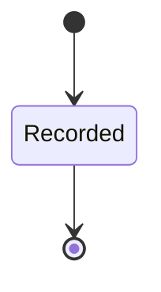

<!-- generated by thalamus-docs, do not edit -->

One reading of one signal for one series. Append-only; a sample has no lifecycle beyond being recorded.

`thalamus.observation` is one of thalamus's bounded contexts. [All domains](./index.mdx).

## Types

### `Bound`

`thalamus.observation.Bound` is one of `lower` and `upper`.

### `CompleteReading`

`thalamus.observation.CompleteReading` is a record of one field:

- `value` — `Decimal`

### `Denominator`

`thalamus.observation.Denominator` is a record of four fields:

- `n` — `Integer`
- `unit` — `thalamus.definition.Unit`
- `since` — `Timestamp`
- `age_s` — `Integer`

### `PartialReading`

`thalamus.observation.PartialReading` is a record of two fields:

- `value` — `Decimal`
- `bound` — `thalamus.observation.Bound`

### `Provenance`

`thalamus.observation.Provenance` is a record of seven fields:

- `producer` — `String`
- `version` — `String`
- `definition_rev` — `Integer`
- `adapter` — `thalamus.definition.AdapterId`
- `connection` — `thalamus.definition.ConnectionId`
- `query_sha256` — `thalamus.observation.QueryDigest`
- `run_id` — `thalamus.observation.RunId`

### `QueryDigest`

`thalamus.observation.QueryDigest` wraps `String` and is not interchangeable with one: the whole value of naming it separately is the crossings the model then refuses. Its characters are drawn from `0123456789abcdef`.

### `Reading`

`thalamus.observation.Reading` is one of three shapes, told apart by a `quality` field — tagged, so a decoder never has to guess which branch it is reading:

- `ok` — `thalamus.observation.CompleteReading`
- `partial` — `thalamus.observation.PartialReading`
- `unknown` — `thalamus.observation.UnreadReading`

### `RunId`

`thalamus.observation.RunId` wraps `String` and is not interchangeable with one: the whole value of naming it separately is the crossings the model then refuses. Every value starts with `run_`.

### `SampleId`

`thalamus.observation.SampleId` wraps `String` and is not interchangeable with one: the whole value of naming it separately is the crossings the model then refuses. Every value starts with `smp_`.

### `SeriesKey`

`thalamus.observation.SeriesKey` wraps `String` and is not interchangeable with one: the whole value of naming it separately is the crossings the model then refuses.

### `TimeWindow`

`thalamus.observation.TimeWindow` is a record of two fields:

- `start` — `Timestamp`
- `end` — `Timestamp`

### `UnreadReading`

`thalamus.observation.UnreadReading` is a record of one field:

- `reason` — `String`

## Entities

An entity is what this context is about: something with an identity that outlives any one request, a shape, and a lifecycle. The lifecycle is exhaustive — a move that is not drawn below is a move this specification does not permit, and that is the only way it says so. Every move is labelled with the command that takes it, because a move nothing can trigger is refused rather than drawn.

### `SignalSample`

`thalamus.observation.SignalSample`.

An instance is identified by `sample_id`, a `thalamus.observation.SampleId`. The name is part of the model and not a convention: a view projects the identity under that name, so a projection inventing its own would disagree with the view.

It holds:

- `signal` — `thalamus.definition.SignalId`
- `series` — `thalamus.observation.SeriesKey`
- `dims` — `Map<String, thalamus.dimension.DimensionValue>`
- `ts` — `Timestamp`
- `window` — `thalamus.observation.TimeWindow`
- `reading` — `thalamus.observation.Reading`
- `unit` — `thalamus.definition.Unit`
- `denominator` — `Optional<thalamus.observation.Denominator>`, which may be absent
- `provenance` — `thalamus.observation.Provenance`

It references at most one [`thalamus.definition.SignalDefinition`](thalamus-definition.md#signaldefinition), as `definition`, carried by `SignalSample.signal`.

No invariant is declared, so nothing here constrains an instance at rest.

Its state is a `thalamus.observation.SignalSample.State`, one of `Recorded`. That enum is synthesised from the lifecycle rather than declared beside it, so the states a view's filter compares and the states drawn below cannot disagree.

An instance is created in `Recorded`. `Recorded` is terminal, so an instance may rest there forever. That is declared rather than inferred from having no way out: an entity that cannot leave a state is either finished or stuck, and only its author knows which.

It declares no moves, so nothing changes its state once it exists.

It has one state, so there is no move to permit or to forbid.

Two views project it: [`Samples`](#samples) and [`SeriesSamples`](#seriessamples).

## Views

A view is what the outside world is promised it can observe. Each one says which instances it contains and how soon it reflects a command that has already returned, because "you can read this" without "how soon" is the promise every flaky suite is built on.

### `Samples`

`thalamus.observation.Samples`, shown to a person as "Samples" and called `samples` on the wire.

It reads [`SignalSample`](#signalsample).

It contains every instance of that entity: no filter narrows it, which is a decision somebody made and not a line somebody omitted.

It exposes:

- `sample_id` — `thalamus.observation.SampleId`
- `signal` — `thalamus.definition.SignalId`
- `series` — `thalamus.observation.SeriesKey`
- `dims` — `Map<String, thalamus.dimension.DimensionValue>`
- `ts` — `Timestamp`
- `window` — `thalamus.observation.TimeWindow`
- `reading` — `thalamus.observation.Reading`
- `unit` — `thalamus.definition.Unit`
- `denominator` — `Optional<thalamus.observation.Denominator>`, which may be absent
- `provenance` — `thalamus.observation.Provenance`
- `state` — `thalamus.observation.SignalSample.State`

It declares no order, so the rows come back in whatever order the implementation has, and two reads may disagree.

**Read-your-writes**: it is current the moment the command that changed it returns. A caller that has just created an invoice and cannot see it in here has been told a lie about what it did.

A generated scenario asserts it once, immediately after the command: a view promising this and not keeping the promise has to fail the suite rather than be retried until it passes.

### `SeriesSamples`

`thalamus.observation.SeriesSamples`, shown to a person as "Samples of a series" and called `series` on the wire.

It reads [`SignalSample`](#signalsample).

It contains the instances where `series == param.series` holds, and only those — so an instance a caller cannot find in here has been filtered out rather than lost.

It exposes:

- `sample_id` — `thalamus.observation.SampleId`
- `ts` — `Timestamp`
- `window` — `thalamus.observation.TimeWindow`
- `reading` — `thalamus.observation.Reading`
- `unit` — `thalamus.definition.Unit`
- `denominator` — `Optional<thalamus.observation.Denominator>`, which may be absent

Its rows are ordered by `ts` ascending.

**Read-your-writes**: it is current the moment the command that changed it returns. A caller that has just created an invoice and cannot see it in here has been told a lie about what it did.

A generated scenario asserts it once, immediately after the command: a view promising this and not keeping the promise has to fail the suite rather than be retried until it passes.

## Commands

### `RecordSample`

`thalamus.observation.RecordSample`, shown to a person as "Record a sample" and called `record` on the wire.

It takes:

- `signal` — `thalamus.definition.SignalId`
- `series` — `thalamus.observation.SeriesKey`
- `dims` — `Map<String, thalamus.dimension.DimensionValue>`
- `ts` — `Timestamp`
- `window` — `thalamus.observation.TimeWindow`
- `reading` — `thalamus.observation.Reading`
- `unit` — `thalamus.definition.Unit`
- `denominator` — `Optional<thalamus.observation.Denominator>`, which may be absent
- `provenance` — `thalamus.observation.Provenance`

It has three outcomes.

**`unknown-signal`** — No definition has this id; nothing was recorded. Taken when no `thalamus.definition.SignalDefinition` carries the identity `input.signal` names. No entity in this specification changes. It reports `thalamus.observation.UnknownSignal`, carrying `signal`. It emits nothing. A test reaches it by arranging the row of the other entity the input names, or its absence, and sending the command for it.

**`not-active`** — The definition is not Active; nothing was recorded. Taken when the `thalamus.definition.SignalDefinition` that `input.signal` names exists and its stored fields satisfy `state != Active`. No entity in this specification changes. It reports `thalamus.observation.SignalNotActive`, carrying `signal`. It emits nothing. A test reaches it by arranging the row of the other entity the input names, or its absence, and sending the command for it.

**`recorded`** — The sample is recorded and its id returned. The default branch, taken when no other outcome's condition matched. It creates a `thalamus.observation.SignalSample`, which starts in `Recorded`. The new instance's identity is published as `sample_id` on `thalamus.observation.SampleRecorded`. It emits `thalamus.observation.SampleRecorded`. It sets `signal` from `input.signal`, `series` from `input.series`, `dims` from `input.dims`, `ts` from `input.ts`, `window` from `input.window`, `reading` from `input.reading`, `unit` from `input.unit`, `denominator` from `input.denominator` and `provenance` from `input.provenance`. A test reaches it by constructing an input that satisfies no other outcome's condition.

## Events

### `SampleRecorded`

`thalamus.observation.SampleRecorded`.

It carries:

- `sample_id` — `thalamus.observation.SampleId`
- `signal` — `thalamus.definition.SignalId`
- `series` — `thalamus.observation.SeriesKey`
- `ts` — `Timestamp`

Emitted by `thalamus.observation.RecordSample` on its `recorded` outcome.

Nothing in this system reacts to it.

## Errors

### `SignalNotActive`

Only an Active definition is sampled; this one is Proposed, Muted or Retired, so nothing was recorded.

It carries:

- `signal` — `thalamus.definition.SignalId`

Reported by `thalamus.observation.RecordSample` on its `not-active` outcome.

### `UnknownSignal`

No definition has this signal id; nothing was recorded.

It carries:

- `signal` — `thalamus.definition.SignalId`

Reported by `thalamus.observation.RecordSample` on its `unknown-signal` outcome.

## Actors

An actor is who may ask this context for something. Every grant below points at a command this specification declares — a grant is a resolved reference, so "may invoke" something nobody wrote is not a permission this model can express, and an authorisation that authorises nothing cannot ship quietly.

### `Sampler`

`thalamus.observation.Sampler`.

It may invoke [`RecordSample`](#recordsample).

---

Generated from thalamus v1 · model digest `36486c1af727e3970e09eee21ce103728cca8a5870e0da6c3e5e285eb66f6345` · contract digest `slice-sha256/2:d1045dde710e29ff13ecbf6eb1710103eb27b96e7c9a379522d34c8b56a2c89e`. Do not edit this file; change the specification and regenerate it with `task generate`.
